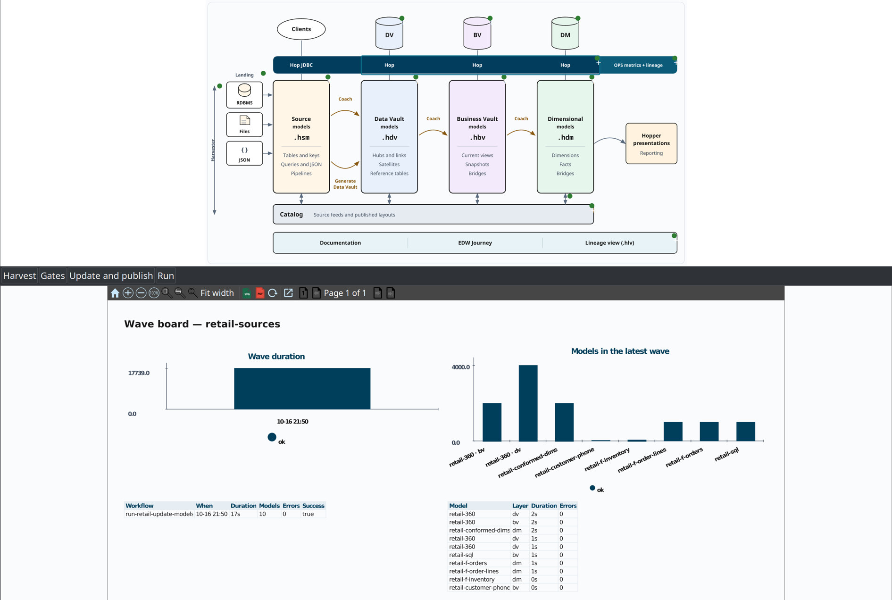

= EDW Journey perspective
:toc: macro
:toclevels: 3

toc::[]

The **EDW Journey** perspective is the Hop GUI map of one warehouse: source models and catalog feeds, harvest / schema gate / quality controls, raw Data Vault, Business Vault, dimensional models, the workflows that run them, and generated reports.

It does not replace the Data Catalog, model canvases, execution maps (`.hem`), or Hop Lineage Views (`.hlv`). Those stay the editors. Journey **lists** them in operate order and **opens** the existing surface.

Architecture picture: link:architecture.adoc#d7-edw-journey[Architecture — D7]. The spine is still the link:resource-definition-group.adoc[resource definition group].

== Architecture poster

Opening the perspective, or selecting the resource definition group, shows the same architecture drawing as the overview poster. A green check, an amber dot, or a red cross sits on a block when the project or the last OPS run has something to say. Documentation, clients, JDBC, presentations, the Journey block itself, and Coach stay unmarked. A layer with no model is unmarked as well. That is an empty stage, not a failure.

Click a block, or use **Harvest**, **Gates**, **Update and publish**, or **Run** under the drawing. The panel under the drawing is a Hopper presentation in the same light colors as the poster. The report toolbar sits at the top of that panel: zoom, fit width, refresh, export, and a Float icon that opens the presentation in its own window. The page opens fitted to the width of the panel. A short trend is shown when history exists, and a table you can click sits beside or under the chart. One harvest or one wave is a single bar. **Run** opens the wave board: how long the last wave took, and how long each model in that wave took. Click a bar or its label to open that model. Escape returns to Project pulse. Selecting a model in the tree shows its details (path, last run, Open).

A click in the panel opens the matching place:

[cols="1,2", options="header"]
|===
|Click |Where it goes

|A source subject
|The `.hsm` card, selected and centered. Double-click opens the card. Browse is a separate link on the row when the file is known.

|A vault, business vault, or dimensional table
|That model, with the table selected. Double-click opens the dialog. A dimensional fact can also open its update pipeline or its `.hsl` file.

|A catalog feed
|The record in the Data Catalog. Double-click goes to the origin model when the feed has one.

|Harvest, Validate, versions, lineage, the group, operational analytics
|The existing dialog or metadata editor. Generate Data Vault still opens the review dialog. Nothing is generated by the click itself.
|===

The offline talk page `docs/presentations/edw-component-explorer.html` is unchanged. It still opens pancards of explanation and screenshots.

== Open the perspective

The sidebar button sits after **Data catalog** (plugin id `360-EdwJourneyPerspective`). The top of the left pane is a **resource definition group** picker (Hop metadata line: dropdown, New, Edit, open in Metadata). If the project has one group, it is selected. Otherwise the last-used group is restored. Use the dropdown to switch groups; **New** creates a group without leaving the perspective.

From a resource definition group metadata editor, **Open in EDW Journey**.

== Tree

Stages are always present, even when empty. Child order is the operate wave plus layer load order (all DV, then BV, then DM; list order within a layer).

[cols="1,3", options="header"]
|===
|Stage |What you see

|**1. Sources**
|`.hsm` files discovered from catalog `RecordOrigin` of feeds the group's models use, then those catalog feeds

|**2. Controls**
|Harvest, schema gate, source quality, catalog version tags

|**3. Raw Data Vault**
|`.hdv` paths on the group, in update order. Expand a model for table names.

|**4. Business Vault**
|`.hbv` paths on the group

|**5. Dimensional**
|`.hdm` paths on the group

|**6. Target quality**
|Placeholder for post-load quality (last-run overlay is a later phase)

|**7. Orchestration**
|Project `.hwf` files whose actions name this group (skips `work/` and build dirs)

|**8. Outputs**
|`work/reports`, `work/execution-maps`, and project `.hlv` files
|===

The grain is **artifact / model file / run**, not every column. Table-level lineage stays on the model Lineage tab and on `.hlv`.

== Details and Open

Select a node for identity (path, catalog key, table count) and buttons that jump to:

* Source / DV / BV / DM model canvases
* Data Catalog record
* Resource definition group metadata
* Workflow, report, `.hem`, or `.hlv` file
* Harvest history, **Validate sources**, reverse lineage browser, catalog versions

Each selected level also has **Documentation** buttons (help icon) that open the matching plugin HTML guide in the browser — for example source modeler, harvest, schema gate, Data Vault, Business Vault, dimensional modeler, execution maps, or Hop Lineage View. The same HTML set is on the main toolbar **EDW** button and **Help → EDW documentation**.

The Journey toolbar **AI Help** opens the Hop AI Assistant on the current group snapshot (chat only: what is in the group, what to do next). See link:ai-advisory.md[AI advisory].

Double-click is the primary Open action for models, feeds, workflows, and files.

== Last run and problems

Selecting the group, Harvest, Source quality, Target quality, a model, or Orchestration shows **last-run** facts from the OPS database when it is configured (harvest `schema_harvest_run`, quality `quality_run`, load `workflow_load_overview` / `load_run`). Tree labels gain a short suffix (status, duration, change count).

A **Problems** table lists harvest drift, blocking quality findings, and failed loads. Missing OPS is **never run**, not an error.

Use the existing **Harvest history…** / **Validate sources…** buttons to open the full browsers. Model nodes also list recent load durations from `load_run`.

== Grow the warehouse

Stage nodes offer create/add actions that write through existing GUI surfaces (not a parallel file-only config):

* **Sources** — New source model; Import catalog feeds
* **Raw Data Vault** — New `.hdv`, add existing `.hdv` to the group, **Generate Data Vault from source model** when an `.hsm` is present (adds the resulting `.hdv` to the group when possible)
* **Business Vault / Dimensional** — New model file under `${PROJECT_HOME}/models/`, or add an existing project file to the group
* **Source quality** — New quality rule set metadata
* **Group** — Configure EDW setup

The resource definition group editor remains the full editor for model lists.

== Empty project

With no resource definition group, the details pane offers **Configure EDW setup…**, **New resource definition group…**, and documentation for getting started, the resource definition group, Configure EDW, and this perspective. Create the group as soon as the first `.hdv` checks clean — see link:getting-started-edw.adoc#chapter-3[Getting started — Chapter 3].

== What this is not

* Not a second Explorer (no folder dump).
* Not a second Data Catalog (no namespace listing of every record).
* Not an execution map graph and not a lineage graph.
* Not a place that **runs** harvest, the schema gate, quality, or Update resource definition group.

== Related documents

* link:architecture.adoc[Architecture]
* link:resource-definition-group.adoc[Resource definition group]
* link:getting-started-edw.adoc[Getting started — building an EDW]
* link:operations.adoc[Operations]
* link:hop-lineage-view.adoc[Hop Lineage View]
* link:execution-maps.adoc[Execution maps]
