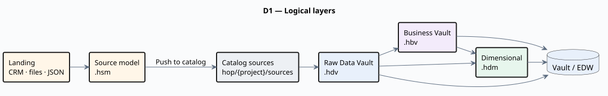
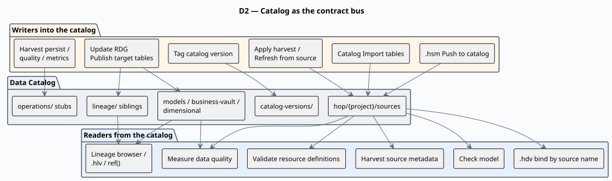
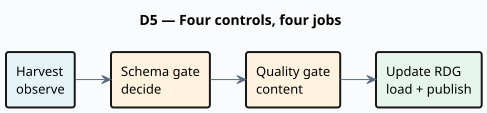
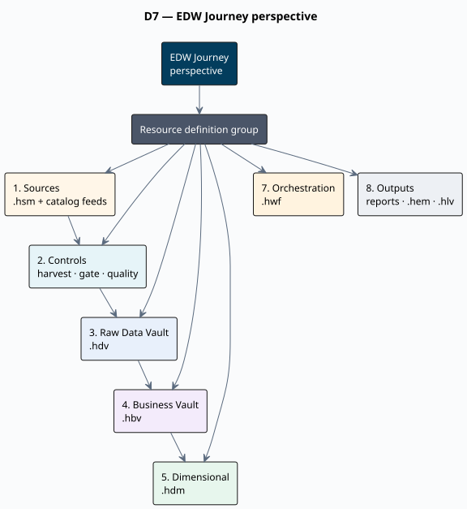
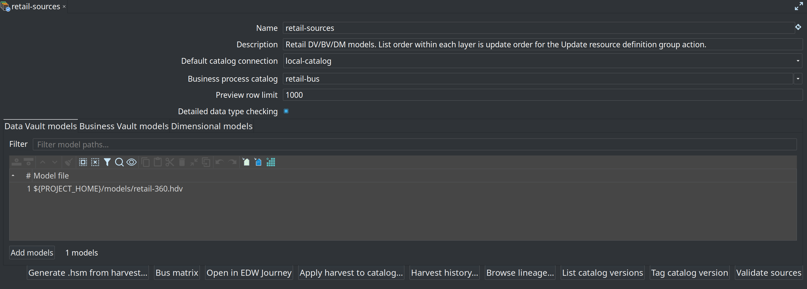
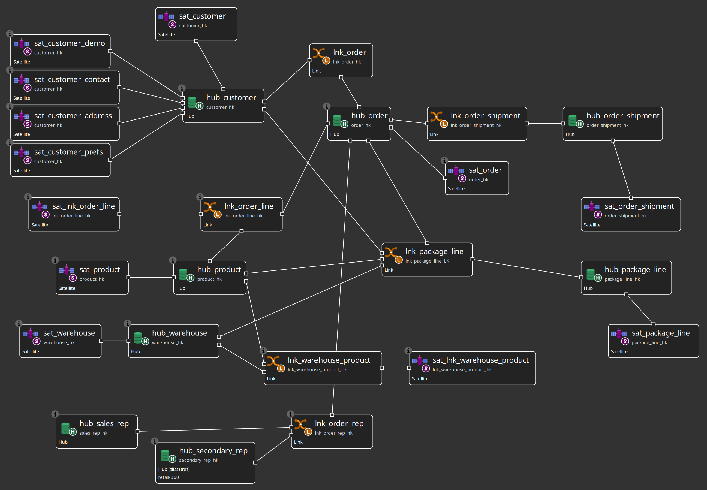

= Module 0 — Orientation: the EDW Journey
:toc: left
:toclevels: 2
:sectanchors:

++++
<link rel="stylesheet" href="quiz.css" />
++++

== Why it matters

Data Hopper EDW turns Apache Hop into a warehouse factory: you describe sources, vaults, and marts
as model files and Hop generates and runs the pipelines that build them. Without a map, six model
file types and four layers look like six products. With the map, every later module is one more step
on the same road.

This module gives you that map and shows where each job happens in Hop GUI. No database is needed:
you only read the `retail-example` project. Budget 25 minutes.

== Concepts

=== Four layers, one road

Source systems land in a catalog, the catalog feeds a **raw Data Vault**, that feeds a **Business
Vault**, and that feeds **dimensional marts**. Each layer has one job: sources are contracts, the raw
vault is history, the business vault is interpretation, the marts are consumption.

=== The catalog is the contract bus

Nothing is wired by JDBC URL. A source model publishes **feeds** into the Data Catalog under
`hop/{project}/sources`, hubs and satellites bind to those feed **names**, and a load publishes the
target layouts back. Rename a column in the catalog and every model that uses it knows.

=== The resource definition group is the spine

A resource definition group is the list of warehouse models one warehouse consists of. Harvest,
schema validation, version tags, and loading all take the group as their scope — which is why you
create the group early and grow it, instead of starting a new one per subject area.

=== Model files

[cols="1,3", options="header"]
|===
|Extension |What it describes

|`.hsm`
|Source model: tables, primary/foreign keys, joins, JSON and pipeline feeds

|`.hdv`
|Raw Data Vault model: hubs, links, satellites, reference tables

|`.hbv`
|Business Vault model: SCD2, PIT, bridges, SQL business tables

|`.hdm`
|Dimensional model: facts, dimensions, date dimensions

|`.hsl`
|Semantic layer over a `.hdm` (consumption metadata, saved selections)

|`.hem`
|Execution map: what ran, in what order, with what result

|`.hlv`
|Hop Lineage View: a graph definition over a lineage backend
|===

=== Build order and the four controls

Build in the order the catalog allows: source model → publish to catalog → generate the raw vault →
create the resource definition group → first load → Business Vault → dimensional marts. Around that
run four controls: **Check model** (build time), **metadata harvest**, the **schema gate**, and
**data quality**. Confusing those four is the most common beginner mistake — they answer different
questions.

=== Where you work in Hop GUI

The **EDW Journey** perspective draws a resource definition group as the warehouse map: sources,
controls, raw vault, business vault, dimensional, orchestration, outputs. It is the fastest way to
see what a warehouse contains and which piece owns a table.

== Guided walkthrough

=== Open the finished warehouse

. Start Hop GUI and open the project folder `retail-example/` (**File → Open project**).
. Open the **EDW Journey** perspective (perspectives row, after **Data catalog**).
. In the group combo at the top, select **`retail-sources`**.
. Expand **1. Sources**: you see the source model `.hsm` files discovered from the catalog, then the
catalog feeds themselves (namespace `hop/retail-example/sources`).
. Expand **3. Raw Data Vault** and its child **`retail-360.hdv`**: the hub, link, and satellite table
names appear under it.
. Select **`retail-360.hdv`** and press **Documentation** — the offline HTML guide for that model
opens. This is the same documentation set these training modules ship in (toolbar **EDW** button, or
**Help → EDW documentation**), and it works with no network.
. Expand **4. Business Vault**, **5. Dimensional**, **7. Orchestration**, and **8. Outputs** to see
the rest of the same warehouse: `.hbv` and `.hdm` files, the workflows that name the group, and where
reports and execution maps land.
+

. Select **1. Sources** and press **Details → Open catalog** to see the published feeds that the whole
warehouse is wired to.
. Open **`models/retail-360.hdv`** in the modeler and use **Browse** on one hub: the canvas centers
the table and its neighbours, which is the fastest way to read a vault you did not write.
+

== Try it yourself

Pick one business concept that matters to you (customer, order, product) and write down its path
through the warehouse, from the journey tree only:

. Find the **hub** for that concept under **3. Raw Data Vault**.
. Find at least one **satellite** of that hub and note the descriptive columns it would carry — open
the table dialog (**Details → Open model**, then double-click the table) and read the **Fields**.
. Find the **catalog feed** the satellite's hub binds to under **1. Sources**.

Check your work: the hub name starts with `hub_`, the satellite name with `sat_`, and the feed name
is a catalog entry — not a database table. If you wrote a `test_edw` table name, re-read the
*Concepts* section on the catalog above.

== Questionnaire

Answer the six questions. Every answer comes with its reasoning, and **Copy my results** gives you a
text summary to keep.

++++

  

    
1. Which file extension holds the raw Data Vault model?

    

      <button type="button" class="edw-quiz-option">a) .hsm</button>
      <button type="button" class="edw-quiz-option" data-correct="true">b) .hdv</button>
      <button type="button" class="edw-quiz-option">c) .hbv</button>
      <button type="button" class="edw-quiz-option">d) .hdm</button>
    

    
<strong>b)</strong> <code>.hdv</code> is the raw Data Vault model. <code>.hsm</code> is the source model, <code>.hbv</code> the Business Vault model and <code>.hdm</code> the dimensional model.

  

  

    
2. Where does a hub get the name of the source it reads?

    

      <button type="button" class="edw-quiz-option">a) From the JDBC URL of the source connection</button>
      <button type="button" class="edw-quiz-option" data-correct="true">b) From a catalog feed name published under <code>hop/{project}/sources</code></button>
      <button type="button" class="edw-quiz-option">c) From the physical table name in the landing database</button>
      <button type="button" class="edw-quiz-option">d) From the workflow that loads it</button>
    

    
<strong>b)</strong> Contracts live in the Data Catalog and models bind to feed <em>names</em>. The physical table is an implementation detail of the feed; nothing in the vault points at a JDBC URL.

  

  

    
3. What is a resource definition group?

    

      <button type="button" class="edw-quiz-option">a) A folder of database connections</button>
      <button type="button" class="edw-quiz-option">b) A runtime log of the last load</button>
      <button type="button" class="edw-quiz-option" data-correct="true">c) The list of warehouse models — .hdv, .hbv and .hdm files — one warehouse consists of</button>
      <button type="button" class="edw-quiz-option">d) A saved catalog version</button>
    

    
<strong>c)</strong> The group is the scope of harvest, schema validation, version tags and loading. Growing the warehouse means adding models to the same group, not creating a second one.

  

  

    
4. In the recommended build order, when is the raw Data Vault generated?

    

      <button type="button" class="edw-quiz-option">a) Before the source model exists, from the landing tables</button>
      <button type="button" class="edw-quiz-option" data-correct="true">b) After the source model is published to the catalog, and before the first load</button>
      <button type="button" class="edw-quiz-option">c) After the first load, from the loaded tables</button>
      <button type="button" class="edw-quiz-option">d) Only after the dimensional models exist</button>
    

    
<strong>b)</strong> Contracts first (source model → catalog), then the vault model (generate from the source model, <strong>Check model</strong> until it is clean), then the resource definition group, then the load. Generation creates no tables and no pipelines by itself.

  

  

    
5. Which statement about the four controls is correct?

    

      <button type="button" class="edw-quiz-option">a) They are four names for the same check</button>
      <button type="button" class="edw-quiz-option">b) Check model is a runtime gate; data quality is a build-time check</button>
      <button type="button" class="edw-quiz-option" data-correct="true">c) Check model, harvest, schema gate, and data quality answer four different questions (model correctness, live schema, contract drift, content quality)</button>
      <button type="button" class="edw-quiz-option">d) Harvest replaces the schema gate once a group exists</button>
    

    
<strong>c)</strong> Check model validates the model itself at build time; harvest reads what the databases actually contain; the schema gate compares expected contracts to found schemas against a version tag; data quality measures row content. <a href="../architecture.html#d5-four-controls">Architecture — D5</a>.

  

  

    
6. Scenario: your team wants to add a Business Vault customer view on top of the existing warehouse. What is the right next step?

    

      <button type="button" class="edw-quiz-option">a) Create a second resource definition group for the Business Vault</button>
      <button type="button" class="edw-quiz-option">b) Copy the hub and satellite definitions into the <code>.hbv</code> file</button>
      <button type="button" class="edw-quiz-option" data-correct="true">c) Add the new <code>.hbv</code> to the <strong>Business Vault models</strong> tab of the existing group and run the group update again</button>
      <button type="button" class="edw-quiz-option">d) Load the Business Vault by running the raw-vault workflow twice</button>
    

    
<strong>c)</strong> One warehouse is one group. The group lists DV, BV and DM models; the update action always loads all DV, then all BV, then all DM on the group, in list order.

  

++++

== Where to go next

* link:../architecture.adoc[Architecture] — D1 to D7: layers, catalog bus, group spine, build vs run, the four controls, growth
* link:../edw-journey.adoc[EDW Journey perspective] — every node and button of the tree
* link:../feature-overview.adoc[Feature overview] — the capability list with maturity
* link:module-1-installation-and-setup.adoc[Module 1 — Installation and EDW setup] — next step

'''

[.text-center]
link:index.adoc[← Back to the training index]
