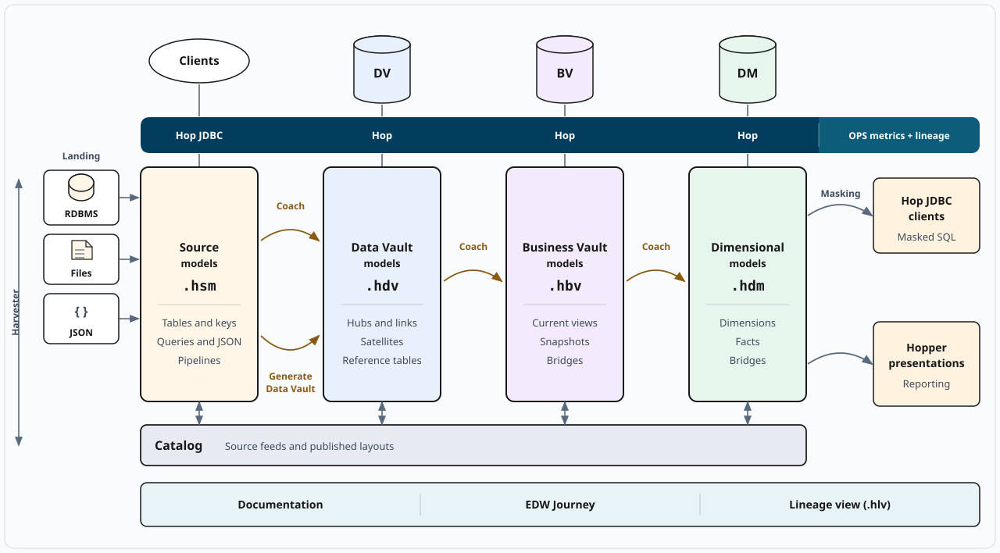
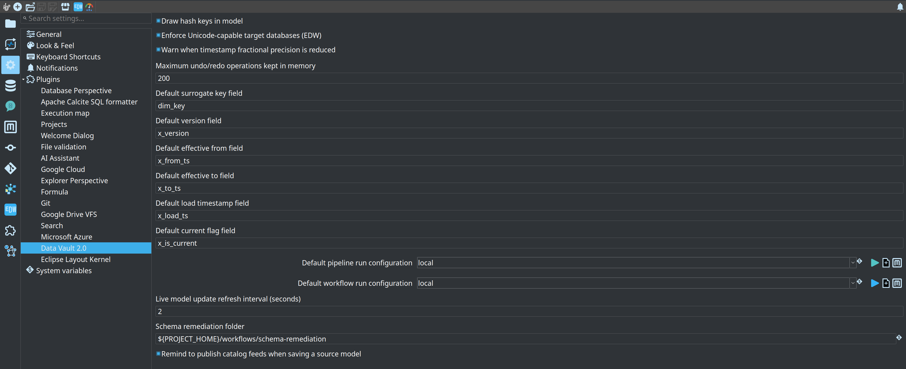
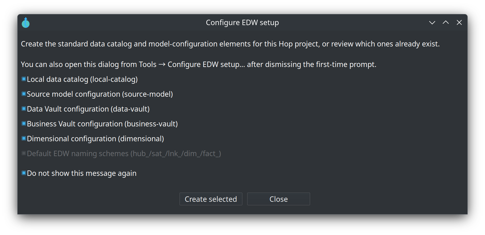

= Module 1 — Installation and EDW setup
:toc: left
:toclevels: 2
:sectanchors:

++++
<link rel="stylesheet" href="quiz.css" />
++++

== Why it matters

Installing the plugin is one command or one unzip; understanding what the install changed is what
saves the next hour. Two install details decide whether a first session works:

* the plugin is not just a jar — the assembly zip also updates `lib/core/` so Jinja-based SQL
  resolves, and
* the version pins are hard: the plugin requires **Apache Hop 2.20** (development builds run
  `2.20.0-SNAPSHOT`) and **Java 21**. Nothing else is supported.

This module installs the plugin by either supported route — **Hop Marketplace** or the **assembly
zip** into `$HOP_HOME` — runs the first-time **Configure EDW setup** helper, and proves the local
training database answers. That foundation is what modules 2 to 8 build on. Budget 30 minutes.

== Concepts

=== The plugin in one picture

The plugin adds four model families to a Hop project — source (`.hsm`), Data Vault (`.hdv`),
Business Vault (`.hbv`) and dimensional (`.hdm`) — plus the catalog and the run outputs around
them. This module builds only the ground floor: the plugin itself, the shared project metadata, and
a database that answers.

=== Where the plugin installs

The assembly zip is a complete plugin layout, not a single file. Unzipped into `$HOP_HOME` it
writes two places:

[source,text]
----
$HOP_HOME/
  plugins/misc/hopper-edw/    plugin jar, icons, and the offline documentation (docs/)
  lib/core/                   Jinja (Jinjava) SQL support
----

Both lines matter. The folder under `plugins/misc/hopper-edw/` is what Hop loads: after a restart,
new metadata types appear under **Metadata → EDW**, the update and validation actions are available
in workflows, and `.hsm`, `.hdv`, `.hbv`, `.hdm` and `.hlv` files open in Explorer tabs. Inside it,
`plugins/misc/hopper-edw/docs/` carries the offline guides — the same folder these training modules
ship in. `lib/core/` receives the Jinja SQL support; copying only the plugin jar is not enough for
Jinja SQL.

=== What Configure EDW setup creates

A new Hop project is offered the standard catalog and the four shared configuration objects the
first time you open a source, Data Vault, Business Vault, or dimensional model. Accept that
first-time prompt, or run **Tools → Configure EDW setup...** from the menu if you dismissed it — the
same dialog appears either way, and it creates, when missing:

* the Data catalog connection **`local-catalog`** — a FILE catalog with default storage
  `${PROJECT_HOME}/catalog-data` (`retail-example` uses a gitignored `work/edw-catalog/` instead),
  and
* the shared model configurations **`source-model`**, **`data-vault`**, **`business-vault`** and
  **`dimensional`** — the objects each model points at with **Configuration** on the **Edit model**
  dialog.

It never recreates what exists: elements already present stay selected and disabled in the dialog,
and only missing ones can be created. And it deliberately does **not** create a resource definition
group — you create that yourself once the first `.hdv` checks clean (module 4).

=== Plugin-wide options

The per-model settings have a global counterpart. Hop GUI keeps the plugin-wide Data Vault 2.0
options under **Configuration → Data Vault 2.0** — for example whether hash key columns are drawn
in the model, and the default-on **Enforce Unicode-capable target databases (EDW)** check. These
settings live in the Hop GUI configuration, not inside the model files.

== Guided walkthrough

=== Install the plugin

Route 1 — **Hop Marketplace** (needs Hop 2.20.0-SNAPSHOT). Import the shareable repository
definition, install the plugin, then restart Hop:

[source,sh]
----
./hop marketplace repo import \
  https://raw.githubusercontent.com/ProjectDataHopper/hopper-edw/refs/heads/main/hop-marketplace-repo.yaml
./hop marketplace install hopper-edw
----

In Hop GUI the same route runs from **Tools → Marketplace…**: import the repository on the
**Repositories** tab, then install from the **Plugins** tab.

Route 2 — **assembly zip** (works offline). Take `hopper-edw-<version>.zip` from a release, or build
your own with `mvn clean package`, and unzip it into `$HOP_HOME`. The zip updates both
`plugins/misc/hopper-edw/` and `lib/core/`; do not copy only the plugin jar out of it, because Jinja
SQL then fails. If you ever installed 0.9.0 as `hop-datavault`, remove
`$HOP_HOME/plugins/misc/datavault` first so the old and new folders do not stack.

Restart Hop after either route so the plugin registry reloads. The install is complete when
**Metadata → EDW** shows the EDW metadata types and a `.hdv` file opens in an Explorer tab.

=== Open the training project

. Start Hop GUI and open the project folder `retail-example/` (**File → Open project**).
. Confirm the connections `CRM`, `Vault` and `OPS` exist in **Metadata → Relational database
connection**. On `retail-example` they ship with the project metadata: `CRM` is the source, `Vault`
is the warehouse, `OPS` is the operations database. On your own project, these three are the first
connections you create.
. From the repository root, start the local database once:
+
[source,sh]
----
./scripts/run-postgres.sh up
----
. Check the success line — it names the endpoint and the extra databases:
`PostgreSQL is ready (test@localhost:54320/test; also test_source, test_edw, test_ops,
test_ops_analytics for retail-example; ...)`. Remember port **54320** and user/password/database
`test`/`test`/`test`; the container is `hop-data-vault-postgres-local`.
. Optional, and only needed for module 7 (lineage, quality and operations): start the local Marquez
stack the same way. It holds the lineage *structure* that a Hop Lineage View reads, while load
durations keep coming from the `OPS` connection.
+
[source,sh]
----
./scripts/run-marquez.sh up
----
. Check its success lines — `Marquez is ready.` followed by
`API: http://localhost:5001/api/v1/lineage` and `UI: http://localhost:3001`. The containers are
`hop-marquez-api`, `hop-marquez-web` and `hop-marquez-db`; `./scripts/run-marquez.sh status` reports
whether the API answers, `down` stops the stack and `reset` wipes its database too.

=== Configure EDW setup

. Open **Tools → Configure EDW setup...** and read the dialog. On `retail-example` everything the
dialog offers already exists, so its elements appear selected and disabled; on a fresh project the
same dialog creates the FILE catalog connection `local-catalog` and the shared configurations.
+

. Open the toolbar **EDW** button (or **Help → EDW documentation**) and confirm the offline
documentation opens — the guides and these training modules ship inside the plugin at
`plugins/misc/hopper-edw/docs/` and load with no network.
. Optional, only on a fresh project: create an empty source model or Data Vault model file
(**Explorer → New**) so the first-time prompt can appear; if you dismissed it, reopen
**Tools → Configure EDW setup...** from the menu. Uncheck **Do not show this message again** if you
want the automatic prompt back.

== Try it yourself

Run the training environment end to end, from the repository root:

[source,sh]
----
# 1. local PostgreSQL (container hop-data-vault-postgres-local, port 54320)
./scripts/run-postgres.sh up

# 2. the finished retail warehouse, so you can compare with your own work later
./scripts/run-hop.sh retail-example workflows/run-retail-initial.hwf

# 3. prove the warehouse database answers
docker exec hop-data-vault-postgres-local psql -U test -p 54320 -d test_edw -c '\dt' | head -20

# 4. optional, for module 7: the local Marquez stack a Hop Lineage View reads
./scripts/run-marquez.sh up
----

The first `run-hop.sh` call builds or reuses the local Hop image (`docker-hop:latest`); if you
rebuilt the plugin and want the image refreshed, force it with `./scripts/rebuild-hop.sh`. The third
command prints the table list of `test_edw`: empty before the first load, or the retail tables after
it — either is fine; the point is that the connection works. The fourth command answers with
`Marquez is ready.` and the API/UI URLs; skip it if you are not going to do module 7, and stop the
stack later with `./scripts/run-marquez.sh down`.

Checkpoint — you can show all five:

* `retail-example` opens in Hop GUI,
* **Tools → Configure EDW setup...** opens and shows `local-catalog` and the four shared
  configurations,
* connection `Vault` reaches the database started by `run-postgres.sh up`,
* `docker exec ... -c '\dt'` answers against `test_edw`, and
* `./scripts/run-marquez.sh status` reports the API accepting requests on
  `http://localhost:5001`.

== Questionnaire

Answer the seven questions. Every answer comes with its reasoning, and **Copy my results** gives
you a text summary to keep.

++++

  

    
1. Which Apache Hop version does this plugin require?

    

      <button type="button" class="edw-quiz-option">a) Any Hop 2.x release; the plugin just targets the 2.x line</button>
      <button type="button" class="edw-quiz-option" data-correct="true">b) Apache Hop 2.20 (<code>2.20.0-SNAPSHOT</code> until GA)</button>
      <button type="button" class="edw-quiz-option">c) Apache Hop 2.19 with a compatibility flag</button>
      <button type="button" class="edw-quiz-option">d) The newest Hop available, whichever version that is</button>
    

    
<strong>b)</strong> The plugin is built against the Hop <strong>2.20</strong> line and requires <code>2.20.0-SNAPSHOT</code> until 2.20.0 is released. The pin is deliberate and does not move without a human decision.

  

  

    
2. Which JDK is the required one?

    

      <button type="button" class="edw-quiz-option">a) Java 8, for legacy pipelines</button>
      <button type="button" class="edw-quiz-option">b) Java 11 LTS</button>
      <button type="button" class="edw-quiz-option">c) Java 17 LTS</button>
      <button type="button" class="edw-quiz-option" data-correct="true">d) Java 21</button>
    

    
<strong>d)</strong> <strong>Java 21</strong> is a hard version pin of this project and the prerequisite the training index lists. Older JDKs are not the supported combination.

  

  

    
3. What does Configure EDW setup create, when the elements are missing?

    

      <button type="button" class="edw-quiz-option">a) A resource definition group with your warehouse models</button>
      <button type="button" class="edw-quiz-option" data-correct="true">b) The FILE catalog connection <code>local-catalog</code> and the shared configurations <code>source-model</code>, <code>data-vault</code>, <code>business-vault</code> and <code>dimensional</code></button>
      <button type="button" class="edw-quiz-option">c) The source and vault databases on the local PostgreSQL server</button>
      <button type="button" class="edw-quiz-option">d) One <code>.hsm</code> file per source system in the project</button>
    

    
<strong>b)</strong> The dialog creates the standard catalog connection and the four shared configuration objects, each only when it is missing. Models point at them with <strong>Configuration</strong> on the <strong>Edit model</strong> dialog.

  

  

    
4. What does Configure EDW setup deliberately NOT create?

    

      <button type="button" class="edw-quiz-option">a) The FILE catalog connection <code>local-catalog</code></button>
      <button type="button" class="edw-quiz-option">b) The shared model configurations</button>
      <button type="button" class="edw-quiz-option" data-correct="true">c) A resource definition group</button>
      <button type="button" class="edw-quiz-option">d) An empty model file per layer</button>
    

    
<strong>c)</strong> It does not create a resource definition group — you create that yourself once the first <code>.hdv</code> checks clean (getting started, chapter 3; module 4). <a href="../datavault-configuration.html#configure-edw-setup">Data Vault configuration — Configure EDW setup</a>.

  

  

    
5. After the install, where does the plugin live inside <code>$HOP_HOME</code>?

    

      <button type="button" class="edw-quiz-option">a) <code>$HOP_HOME/lib/hopper-edw/</code></button>
      <button type="button" class="edw-quiz-option" data-correct="true">b) <code>$HOP_HOME/plugins/misc/hopper-edw/</code></button>
      <button type="button" class="edw-quiz-option">c) <code>$HOP_HOME/plugins/hopper-edw/</code></button>
      <button type="button" class="edw-quiz-option">d) <code>$HOP_HOME/hopper-edw/</code></button>
    

    
<strong>b)</strong> The assembly zip unpacks under <code>plugins/misc/hopper-edw/</code> — jar, icons, and the offline documentation — and updates <code>lib/core/</code> alongside it. The layout has been <code>plugins/misc/hopper-edw/</code> since 0.10.0; 0.9.0 installed as <code>plugins/misc/datavault/</code>.

  

  

    
6. Scenario: a colleague copied only the plugin jar out of the assembly zip into their Hop installation. Hop starts, but pipelines that generate Jinja-based SQL fail. What is the missing piece?

    

      <button type="button" class="edw-quiz-option">a) The jar belongs in <code>$HOP_HOME/lib/</code> instead of <code>plugins/</code></button>
      <button type="button" class="edw-quiz-option" data-correct="true">b) The rest of the assembly zip — it also updates <code>lib/core/</code> with the Jinja (Jinjava) SQL support; the jar alone is not enough</button>
      <button type="button" class="edw-quiz-option">c) The Marketplace repository import — zip installs are not supported</button>
      <button type="button" class="edw-quiz-option">d) Nothing; Jinja-based SQL needs a running warehouse first</button>
    

    
<strong>b)</strong> Unzip into <code>$HOP_HOME</code> so both <code>plugins/misc/hopper-edw/</code> and <code>lib/core/</code> (Jinjava) are updated. Copying only the plugin jar is not enough for Jinja SQL.

  

  

    
7. The local training database: which endpoint and credentials does <code>run-postgres.sh up</code> prepare?

    

      <button type="button" class="edw-quiz-option">a) <code>localhost:5432</code>, user <code>postgres</code></button>
      <button type="button" class="edw-quiz-option" data-correct="true">b) <code>localhost:54320</code>, user/password/database <code>test</code>/<code>test</code>/<code>test</code></button>
      <button type="button" class="edw-quiz-option">c) <code>localhost:54320</code>, user <code>sa</code></button>
      <button type="button" class="edw-quiz-option">d) <code>localhost:5433</code>, user/password/database <code>test</code>/<code>test</code>/<code>test</code></button>
    

    
<strong>b)</strong> The script starts the container <code>hop-data-vault-postgres-local</code> on port 54320 with user/password/database <code>test</code>/<code>test</code>/<code>test</code>, and prints <code>PostgreSQL is ready (test@localhost:54320/test; ...)</code>. The same server carries <code>test_source</code>, <code>test_edw</code>, <code>test_ops</code> and <code>test_ops_analytics</code> for the sample.

  

++++

++++

++++

== Where to go next

* link:../datavault-configuration.adoc[Data Vault configuration] — Configure EDW setup, the Edit model dialog, and the plugin-wide options in full
* link:../data-catalog.adoc[Data Catalog] — what the `local-catalog` connection serves and how namespaces work
* link:../getting-started-edw.adoc[Getting started — building an EDW] — chapter 0 bootstrap and the troubleshooting table
* link:module-2-catalog-and-source-models.adoc[Module 2 — Data Catalog and source models] — next step
* link:index.adoc[Training index] — all modules and the training environment

'''

[.text-center]
link:index.adoc[← Back to the training index]
