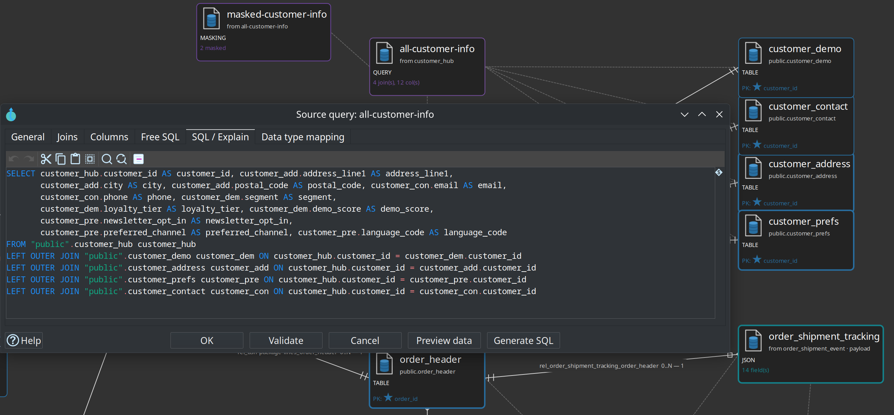
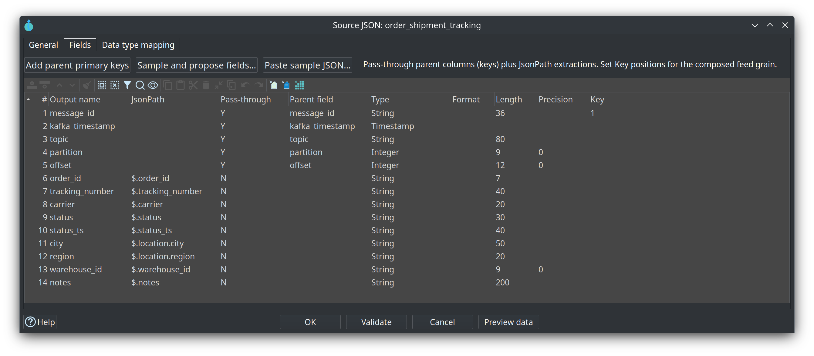
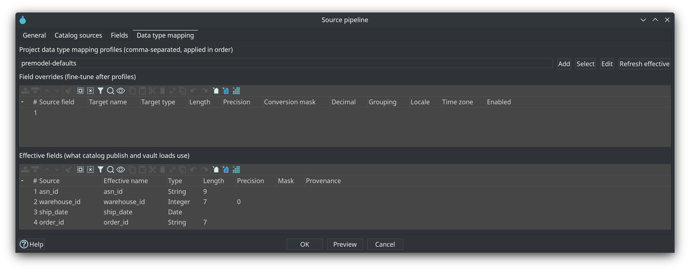
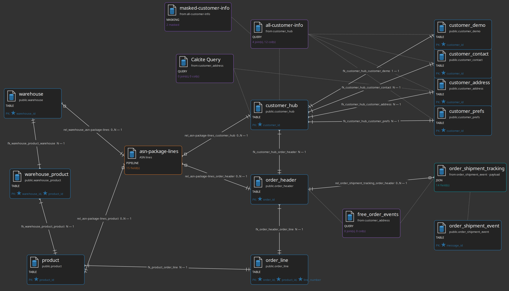
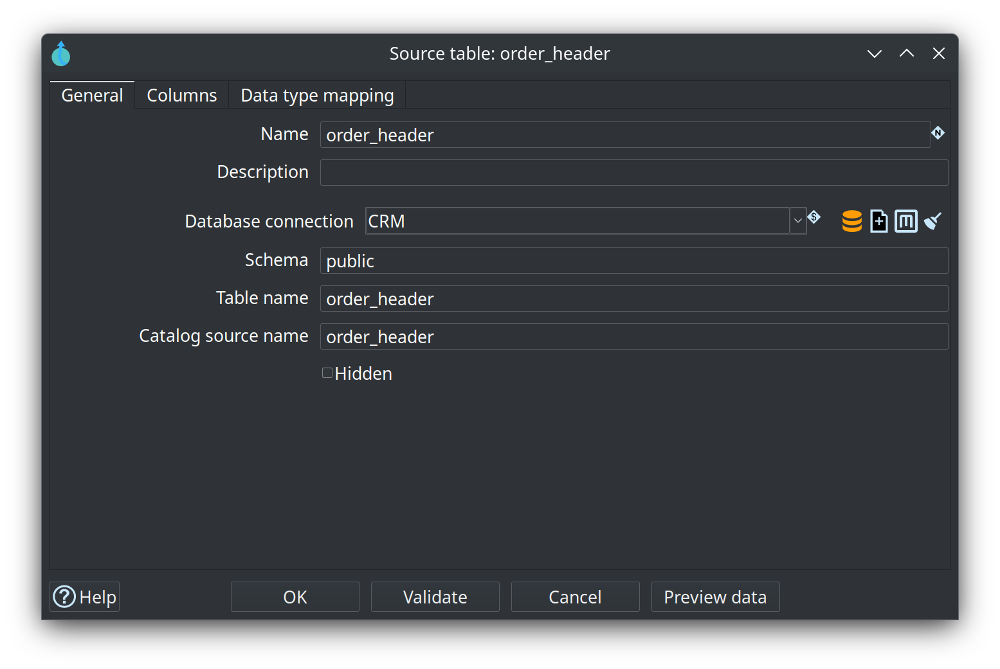

= Module 2 — Data Catalog and source models
:toc: left
:toclevels: 2
:sectanchors:

++++
<link rel="stylesheet" href="quiz.css" />
++++

== Why it matters

A warehouse that binds to physical table names breaks the first time a table is renamed. Data Hopper
EDW avoids that by keeping the contract in one place: the Data Catalog. A source model (`.hsm`)
imports the structure of a source system and publishes it to the catalog as **feeds**; hubs, links,
satellites and every later layer bind to the feed *name*. Rename a column in the catalog and every
model that uses it knows — rename it only in the database and nothing does.

This is the first step of the build order, before any vault model exists. It shows what a catalog
feed is, how a source model produces one, and how to keep the two in step. No warehouse load is
needed; you read the `retail-example` project and publish feeds of your own. Budget 30-40 minutes.

== Concepts

=== The catalog is the contract bus

The catalog is a bus with two directions. **In:** source feeds (types `DV_SOURCE`, `COMPOSITE`,
`JSON`, `PIPELINE`) published from a source model. **Out:** published DV / BV / DM table layouts,
lineage siblings and operations stubs — written when **Update resource definition group** (or a
per-model update) runs with catalog publish enabled. Harvest does not rewrite working-tree
contracts; apply-harvest and refresh-from-source are explicit actions.

image::../images/diagrams/d2-catalog-bus.svg[The Data Catalog is the contract bus,align="center"]

=== Namespaces, and where a feed lives

A feed is a JSON record definition under a FILE catalog storage directory. The path after the storage
root must match the record's `namespace`, and the catalog key is `namespace/name`. You browse feeds
in the **Data Catalog** perspective and refresh with **F5** when files change on disk. The default
sources namespace is derived from the open project folder: `hop/{project-folder-name}/sources`, so
`retail-example/` publishes under `hop/retail-example/sources`.

Models publish into further namespaces: `hop/{project}/models/{model-name}/` for raw vault table
layouts, `hop/{project}/business-vault/{model-name}/` for BV targets, `hop/{project}/dimensional/`
for dimensional tables, and derived `hop/{project}/lineage/...` records. So “the catalog lost my
feeds after a load” is usually a look in the wrong place: publish writes *targets* under `models`,
while your source feeds stay under `sources`.

=== Record definitions: the DV_SOURCE feed

A **Data Vault Source** is a catalog record definition of type `DV_SOURCE`. It describes a logical
feed that supplies rows to hubs, links and satellites, and it combines two things:

* **DV semantics** — a record source indicator and an optional **group** for partial loads.
* **Physical layout** — a database table, CSV / Parquet / Iceberg, a composite multi-table query, a
  JSON extraction, or a pipeline feed.

Model tables reference the source **name**, not a raw database connection; that name is what appears
in a hub's **Record sources** and a satellite's **Default record source**. Column layout lives in the
record's `dvSource.fields[]` — the authoritative contract. A `physicalTable` (or `physicalFile`)
reference only says *where the rows come from*; it does not hold the columns. Keep the field list
accurate, because that is what model checks and detailed data type checking read.

=== Table cards, and query, JSON and pipeline cards

A source model draws one card per feed, and the card type decides the catalog type that **Push to
catalog** writes:

[cols="1,1,3", options="header"]
|===
|Card |Catalog type |What it adds beyond a physical table

|**Source table**
|`DATABASE`
|The table with its columns and primary keys.

|**Source query**
|`COMPOSITE`
|A named multi-table projection: driving table, ordered joins, column list, optional WHERE.

|**Source JSON**
|`JSON`
|A named JSON extraction over a parent table, query or JSON source: JsonPath fields plus
pass-through keys.

|**Source pipeline**
|`PIPELINE`
|A feed that already exists as a Hop pipeline, with declared output fields.
|===

The retail example uses all of them. `models/source-tables-crm.hsm` models the CRM landing tables
plus a query **All customer info** (`feed_customer_enriched`), a Source JSON
**order_shipment_tracking** (`feed_order_shipment_tracking`) and a pipeline source
**asn-package-lines**.

=== Import schema brings in more than columns

**Import schema** asks for an RDBMS connection and an optional schema filter, then for a multi-select
of tables. It imports the columns **and the primary keys**, and it discovers the database's foreign
keys as **relationship** edges on the canvas. If the database has no foreign keys, the tables and
primary keys still arrive; you draw the relationships yourself with **Shift+drag** (or middle-button
drag) between cards.

Every card also has a **Data type mapping** tab, where project profiles and per-field overrides
(rename, type, length, conversion mask, locale, time zone) shape the layout that publish and load
actually use:

=== Catalog version tags

A **catalog version** freezes the **source record definitions** a resource definition group's models
use, under a semantic tag such as `v1.0.0` or `2026-Q3-Release`. Tags are a design-time baseline: the
schema gate compares a live source or the working catalog against a frozen tag, and can do that on a
build machine with no database at all. Snapshots are immutable (editing the working catalog after
tagging does not change them), duplicate tags are rejected, and the model files themselves
(`.hdv` / `.hbv` / `.hdm`) are *not* copied into a snapshot — those stay in Git. Only the FILE catalog
implementation supports versions.

=== Two checks, two questions

**Check model** on the `.hsm` validates the model itself — unique table names, relationship
endpoints, query driving tables, a non-empty projection — and, for any card that already carries a
catalog feed name, that the published feed still matches the card's effective layout. A stale
catalog is an **error**, because the canvas is not what vault loads read. Catalog **validation** is
the other question: feed-level contract checks such as a field added or removed, type or length
drift, or a source that models use but the working catalog lacks. A passing model check still
requires accurate definitions in the catalog; the two layers complement each other.

== Guided walkthrough

=== Find a published feed

. Start Hop GUI and open the project folder `retail-example/` (**File → Open project**).
. Open the **Data Catalog** perspective and expand the namespace `hop/retail-example/sources`.
. Double-click one feed, for example the customer feed the retail vault binds to, and read its
fields: each row is a column with a Hop type, a length and a primary-key position. These are the
contracts hubs and satellites bind to by name.
. Find the physical location reference on the record — the database connection, schema and table the
feed reads. That pointer is an implementation detail of the feed; the field list is the contract.
. Press **F5** (or the refresh action) after editing catalog JSON files on disk.

=== Read a source model

. Open `models/source-tables-crm.hsm` in the source modeler.
. Select a table card and use toolbar **Browse**. The canvas centers that card and draws only its
neighbourhood one or two relationships deep, without rewriting the saved layout — the fastest way to
read part of a source model you did not draw.
+

. Double-click a table card to open it: columns, primary-key positions, and on the **Data type
mapping** tab the profiles and overrides that shape the published layout.
+

. Open a query card and use **Generate SQL** / **Preview data** / **Validate** to see the join the
feed will load. On the General tab, a **Catalog feed name** overrides the name used when publishing
(empty means: use the query name).

=== Bring in your own tables

. Create a new source model (`.hsm`) in your own project and save it, for example `models/crm.hsm`.
. **Edit model**: set the **Catalog connection** to `local-catalog` and the **Configuration** to
`source-model`.
. Toolbar **Import schema**: pick the `CRM` connection, select two tables that relate to each other,
and import. Columns and primary keys arrive, and a database foreign key becomes a relationship edge.
. If no relationship appeared, **Shift+drag** from the child card to the parent card. Open the
relationship dialog to check the child and parent multiplicity (the crow's-foot symbols) if it is not
what you expect.
. Toolbar **Push to catalog**. A multi-select dialog lists every publishable object — tables with
columns as `DATABASE`, queries with a projection as `COMPOSITE`, JSON sources as `JSON`, pipeline
sources as `PIPELINE` — all preselected. Deselect what you do not want and confirm. Feeds that
already exist under the same name are **overwritten**.
. Refresh the Data Catalog (**F5**) and find your feeds under
`hop/{your-project-folder}/sources`.
. Optional: run **Check model** on the `.hsm`. It reports unique names, relationship endpoints,
query driving tables, and whether the published feeds still match the canvas. Fix what it reports,
re-publish, check again.

== Try it yourself

In the catalog, open one of the feeds you just published and read its field list. Then:

. Note the record's `namespace` and `name`; together they form the catalog key that models will bind
to.
. Change nothing yet, and press **Tag version** (**Tag catalog version**) on the catalog connection:
choose the resource definition group that defines the source scope, then enter a tag such as
`v0.1.0`. This freezes the current source contracts.
. Expand **Catalog sources versions** under that connection and open your tag **read-only**. Editing
the working catalog now does not change it.

Checkpoint: your namespace lists at least two feeds, and each feed's field list matches the columns
you imported. If it does not, re-open the model, confirm the catalog connection under **Edit model**,
and **Push to catalog** again.

== Questionnaire

Answer the seven questions. Every answer comes with its reasoning, and **Copy my results** gives you
a text summary to keep.

++++

  

    
1. What is a catalog feed, and where does it live?

    

      <button type="button" class="edw-quiz-option">a) A physical table in the Vault database that hubs read directly</button>
      <button type="button" class="edw-quiz-option" data-correct="true">b) A record definition under a sources namespace, stored as JSON in the FILE catalog and browsed in the Data Catalog perspective</button>
      <button type="button" class="edw-quiz-option">c) A JDBC connection definition in the project metadata</button>
      <button type="button" class="edw-quiz-option">d) A saved SQL script in the project folder</button>
    

    
<strong>b)</strong> A feed is a catalog record definition (for Data Vault sources, of type <code>DV_SOURCE</code>) written as JSON under the FILE catalog storage directory. The path after the storage root matches the record's <code>namespace</code>, for example <code>hop/retail-example/sources</code>, and the catalog key is <code>namespace/name</code>. Hop GUI shows it in the Data Catalog perspective; <strong>F5</strong> refreshes it after edits on disk.

  

  

    
2. What does a <code>DV_SOURCE</code> record definition describe?

    

      <button type="button" class="edw-quiz-option">a) The database connection used by a single hub</button>
      <button type="button" class="edw-quiz-option" data-correct="true">b) A logical feed for hubs, links and satellites, combining DV semantics (record source indicator, optional group) with a physical layout</button>
      <button type="button" class="edw-quiz-option">c) The published layout of a hub, link or satellite table</button>
      <button type="button" class="edw-quiz-option">d) A catalog version tag</button>
    

    
<strong>b)</strong> A Data Vault Source is a catalog record of type <code>DV_SOURCE</code>: a logical feed that supplies rows to hubs, links and satellites. It carries DV semantics (a record source indicator for the vault record-source column, and an optional <strong>group</strong> for partial loads) plus a physical layout — a database table, a composite query, a JSON extraction, a pipeline feed, or a file. Model tables reference the feed <em>name</em>, not a raw connection.

  

  

    
3. What happens on <strong>Push to catalog</strong> when a feed with the same name already exists?

    

      <button type="button" class="edw-quiz-option">a) The push is refused until you rename the card</button>
      <button type="button" class="edw-quiz-option">b) A second feed is created and both appear in the catalog</button>
      <button type="button" class="edw-quiz-option" data-correct="true">c) The existing catalog feed is overwritten</button>
      <button type="button" class="edw-quiz-option">d) The existing feed is kept and the new one becomes a catalog version</button>
    

    
<strong>c)</strong> Push to catalog lists the publishable objects (all preselected) and confirming it <strong>overwrites</strong> existing catalog feeds with the same name. That is why re-publishing a card after a layout change is the normal way to refresh a contract: it keeps the catalog feed current, which is what model checks and vault loads read.

  

  

    
4. Besides columns, what does <strong>Import schema</strong> bring into the model?

    

      <button type="button" class="edw-quiz-option" data-correct="true">a) Primary keys, and foreign keys as relationship edges</button>
      <button type="button" class="edw-quiz-option">b) The catalog version tag of the source tables</button>
      <button type="button" class="edw-quiz-option">c) The data quality rules that are bound to the tables</button>
      <button type="button" class="edw-quiz-option">d) The load pipelines that will read the tables</button>
    

    
<strong>a)</strong> Import schema takes a connection and an optional schema filter, then a multi-select of tables; it imports columns <em>and</em> primary keys, and turns the database's foreign keys into relationship edges. When the database has no foreign keys the tables and primary keys still arrive and you draw the relationships with <strong>Shift+drag</strong> (or middle-button drag). Import does not create pipelines or quality rules.

  

  

    
5. Why do hubs bind to a feed name instead of a physical table?

    

      <button type="button" class="edw-quiz-option">a) Because feed names are shorter than schema-qualified table names</button>
      <button type="button" class="edw-quiz-option" data-correct="true">b) Because the feed is the contract — the physical table is an implementation detail, so a rename or a switch to a join behind the same feed does not break the models</button>
      <button type="button" class="edw-quiz-option">c) Because Hop cannot read a schema-qualified table name</button>
      <button type="button" class="edw-quiz-option">d) Because every hub is allowed to read exactly one physical table</button>
    

    
<strong>b)</strong> Model tables reference the source <em>name</em>, not a raw database connection, and hubs bind to the published feed name. The feed holds the logical identity and layout, so the physical table behind it can be renamed, moved to another schema, or replaced by a composite query without touching the vault models. That is what makes the catalog the one place where a rename is cheap.

  

  

    
6. Scenario: a source table gains a nullable column, and nothing has been re-published since. What should you expect?

    

      <button type="button" class="edw-quiz-option">a) The next vault load adds the column to every satellite of that source</button>
      <button type="button" class="edw-quiz-option" data-correct="true">b) The catalog feed no longer matches the table: refresh the source definition so the contract includes the column, and DV/BV/DM tables change only where a model maps it</button>
      <button type="button" class="edw-quiz-option">c) The hub table gains the column automatically on the next load</button>
      <button type="button" class="edw-quiz-option">d) Nothing can be checked until the column is loaded into the Vault</button>
    

    
<strong>b)</strong> The catalog feed is the baseline the models read, so a new physical column is drift until you refresh the source definition (re-import the table, or use a refresh-from-source proposal). Keeping the field list accurate is what model checks and detailed data type checking use. Downstream DV / BV / DM tables change only where you map the new field, and the schema gate reports the drift against a tagged baseline.

  

  

    
7. What is a catalog version tag for?

    

      <button type="button" class="edw-quiz-option">a) It backs up the Vault database before a load</button>
      <button type="button" class="edw-quiz-option" data-correct="true">b) It freezes the source record definitions a resource definition group uses, as a design-time baseline for schema comparison and CI gates</button>
      <button type="button" class="edw-quiz-option">c) It versions the <code>.hdv</code> / <code>.hbv</code> / <code>.hdm</code> model files</button>
      <button type="button" class="edw-quiz-option">d) It stores the row counts of the last successful load</button>
    

    
<strong>b)</strong> A catalog version snapshots the <strong>source contracts</strong> used by the group's models under a semantic tag such as <code>v1.0.0</code>. Tags are a design-time baseline, independent of DTAP database state; snapshots are immutable and duplicate tags are rejected. Model files stay in Git — they are not copied into a snapshot — and only the FILE catalog supports versions.

  

++++

++++

++++

== Where to go next

* link:../data-catalog.adoc[Data Catalog] — namespaces, record definitions, field layout, catalog versions
* link:../source-modeler-overview.adoc[Source modeler overview] — table, query, JSON and pipeline cards, schema import, Check model
* link:../datavault-source.adoc[Data Vault Source] — the `DV_SOURCE` record definition in detail
* link:../resource-definition-validation.adoc[Resource definition validation] — the schema gate, version baselines and remediation
* link:../getting-started-edw.adoc[Getting started — building an EDW] — chapter 1: source model and publish to the catalog
* link:module-3-raw-data-vault.adoc[Module 3 — Raw Data Vault] — next step
* link:index.adoc[Training index] — modules 1 to 8 are published there as they land

'''

[.text-center]
link:index.adoc[← Back to the training index]
