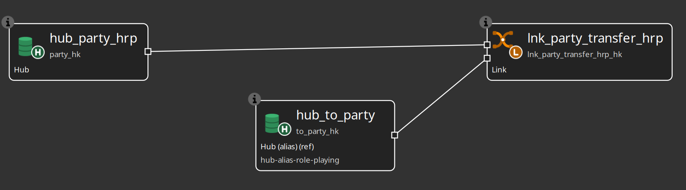
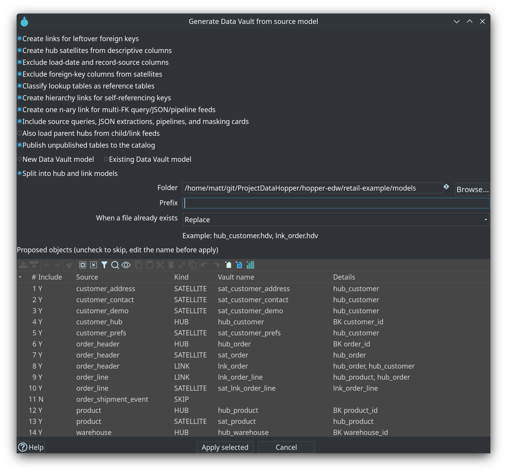
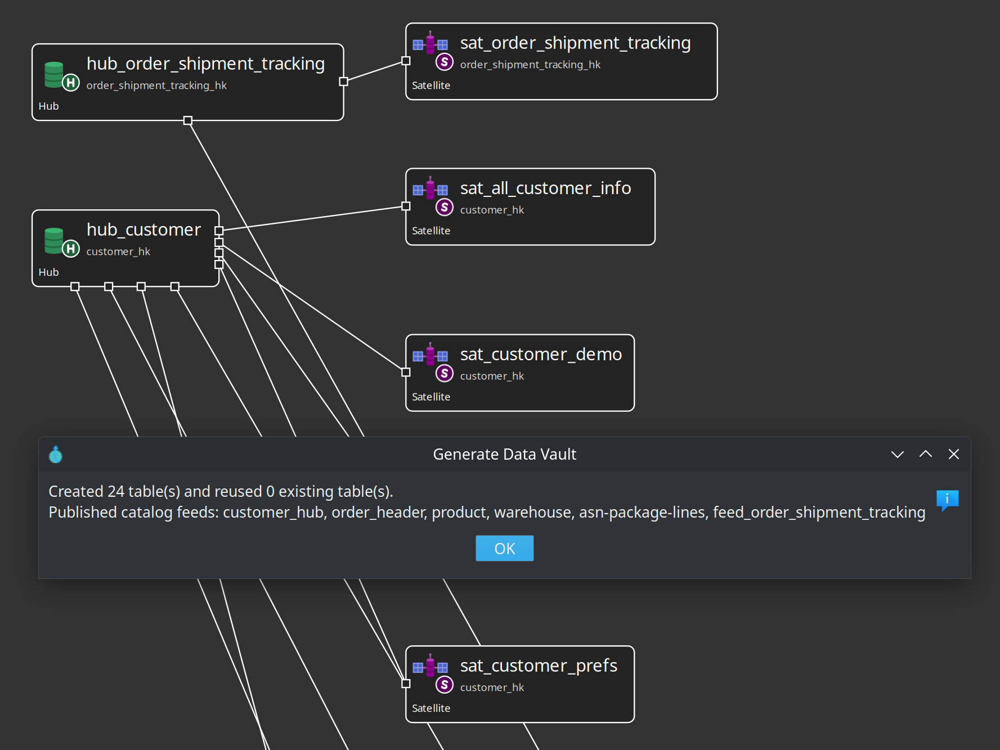
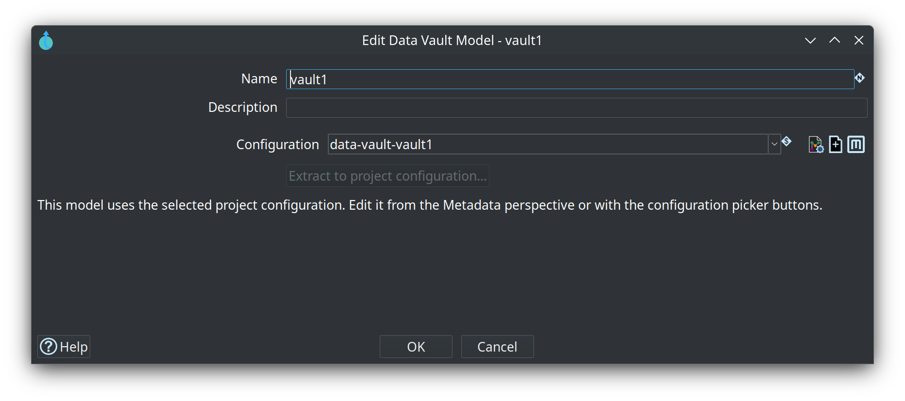

= Module 3 — Raw Data Vault
:toc: left
:toclevels: 2
:sectanchors:

++++
<link rel="stylesheet" href="quiz.css" />
++++

== Why it matters

The raw Data Vault is the history layer of the warehouse. Hubs hold the business keys you must never
lose, links hold the relationships between them, and satellites hold what changed and when — so any
question about the past can be answered from insert-only tables. Every layer above answers to this
one: Business Vault and dimensional models are derived from these hubs, links, and satellites, so a
modelling mistake here is copied into every mart that follows.

This module generates a raw vault from a source model, reads the result the way a vault modeller
does, and validates it with **Check model** before anything is loaded. Budget 35 minutes.

== Concepts

The raw vault sits between the catalog and the Business Vault, and every table in it is one of three
shapes. Each shape has exactly one grain.

image::../images/diagrams/d1-logical-layers.svg[The four layers of a Data Hopper EDW — the raw Data Vault is the history layer,align="center"]

=== Business keys and hash keys

The **business key** is the natural identifier of a concept — `customer_id`, `order_id` — the value
that would still identify the customer if the warehouse were rebuilt from scratch. The **hash key**
is the surrogate the vault stores and joins on: Hop calculates it from the business key with the
model's hash settings (algorithm and storage format, casing, trim, delimiter, null placeholder), all
defined once on **Edit model**.

A hub stores both: its business-key columns plus the hash-key column that links and satellites
reference. Links and satellites never store business-key text — they carry hash keys. A satellite
computes its parent hash from the parent hub's key definitions, applied to columns on its own feed.

=== One grain per table type

* **Hub** — one row per distinct business key. The first time a customer appears, a row is inserted;
  later loads leave it untouched (the insert-only pattern).
* **Link** — one row per distinct relationship between hubs. A *transactional* link adds dependent
  child keys (an order line number, a measurement timestamp), so repeated events keep one row each
  and get their own link hash.
* **Satellite** — one row per change of its tracked attributes for a parent key. Unchanged values
  produce no new row, and **Include in CDC** decides which columns can trigger a version.

When the same physical hub plays two roles on one link (primary/secondary, from/to), the natural hub
keeps the first role and each extra role becomes a **hub alias** with its own role hash column.

=== The audit trail: load date and record source

Every row a load inserts carries the **batch load date** — one timestamp shared by all rows of the
same run, so you can always tell what was processed together. Hubs and links also always store the
**record source**, the indicator of the feed that supplied the row; a satellite stores it too unless
**Store record source indicator** is switched off for a VaultSpeed-style mono-source satellite.
Together the two columns answer the audit questions: when did the warehouse learn this, and who told
it. Change detection itself compares only the tracked attributes, so no-change rows are never
inserted.

=== Integration modes

Vaults are loaded by more than one tool, so every hub, link, and satellite has an integration mode
(hub and link dialogs: **Options** tab; satellite editor: **General** tab). **Hop managed** (the
default) generates DDL and update pipelines. **External read-only** skips generation for a table
another tool loads — dbt, hand-written SQL, legacy ETL — while Hop still documents its structure for
Business Vault and catalog; the canvas marks it `(ext)`. **Custom pipelines** runs your own `.hpl`
files instead of the generator and shows `(custom)`. For a complete existing vault that Hop must not
touch, the model configuration itself has a **Read-only existing vault** switch.

=== Naming schemes

Names are mechanical: a `dv-hub` naming scheme turns `Customer` into `hub_customer`, applied with
**CTRL-SHIFT-N**. Create one scheme per type in the Metadata perspective (**Data definition → Naming
scheme**) and generation uses the type-specific scheme when one exists, otherwise the built-in
`hub_` / `sat_` / `lnk_` / `ref_` prefixes. Check treats a name as conforming when applying the
scheme to the prefix-stripped core reproduces it, so `hub_customer` matches a `hub_` scheme.

== Guided walkthrough

=== Generate, read, and check a vault

The steps use the retail source model, so the result matches the screenshots. Generate into a new
`.hdv` of your own and keep it — module 4 loads it.

. Open `retail-example/models/source-tables-crm.hsm` in the source modeler and press **Generate Data
Vault…** on the toolbar. The review dialog proposes hubs, satellites, links, and reference tables
from the tables, keys, and relationships on the canvas; uncheck any row you do not want and edit
**Vault name** before Apply.
+

. Apply into **New Data Vault model** and save the new `.hdv`. The confirmation counts the tables it
wrote; for the CRM tables the canvas now holds `hub_customer` with its satellites, `hub_order` /
`sat_order` / `lnk_order`, and the rest of the classification.
+

. Press **Edit model** and confirm the bindings: **Configuration** `data-vault`, **Target database**
`Vault`. Open the **Standard columns** tab and read the names every table gets — `LOAD_DATE` and
`RECORD_SOURCE`. These names and the hashing rules are edited once here, for every model that shares
the configuration.
+

. Run **Check model** until it reports no errors. It validates the structure — missing business keys,
unattached satellites, links with fewer than two hubs, duplicate names, references that do not
resolve — and checks every source-to-target mapping for type compatibility, reading the live source
schema when it is available (stored source metadata is the fallback). Then open a satellite by
left-clicking its name on the canvas and read the **Attributes** tab: these are the columns whose
changes create history. Uncheck **Include in CDC** for any column that should never trigger a new
version.

. Open the retail `models/retail-360.hdv` and compare. It has the same three shapes at a larger
scale: several subject areas (customer, order, product, warehouse) and patterns you will meet in
real projects — `lnk_order_line` keeps one row per order line because `line_number` is part of its
link hash.
+
image::../images/data-vault-model-retail-example.png[The retail-360 Data Vault model,align="center"]

. Read one table's **Lineage** tab: the parent hub, the feed, the parent hash key, the attribute
passthroughs, and the standard columns from the model configuration — a read-only answer to where a
field came from, built from the same lineage collectors behind explainable DDL, catalog lineage
siblings, and OpenLineage export.
+
image::../images/data-vault-satellite-dialog-lineage-tab.png[The Lineage tab of a satellite dialog,align="center"]

== Try it yourself

Pick one generated satellite and add a descriptive column that generation did not map.

. Open the satellite on your generated canvas (left-click its name).
. Go to the **Attributes** tab and add a row for a column you know the catalog feed declares. If you
prefer the feed's full list, press **Load from source** instead: it appends the feed's declared
fields, skipping the parent hub's keys automatically, and you keep the column generation missed.
. Give the attribute the data type and length the feed reports.
. Close the dialog and run **Check model** again.

Check your work: the check reports no errors and the new attribute sits in the satellite's attribute
list with a name and length that match a field declared on the satellite's default record source. A
column the feed does not declare fails the check, so if it complains, align the name with the catalog
entry from module 2.

== Questionnaire

Answer the eight questions. Every answer comes with its reasoning, and **Copy my results** gives you
a text summary to keep.

++++

  

    
1. What does one hub row represent?

    

      <button type="button" class="edw-quiz-option">a) One change of the concept's descriptive attributes</button>
      <button type="button" class="edw-quiz-option" data-correct="true">b) One distinct business key, joined on the hash key derived from it</button>
      <button type="button" class="edw-quiz-option">c) One relationship to another concept</button>
      <button type="button" class="edw-quiz-option">d) One load batch in which the key first appeared</button>
    

    
<strong>b)</strong> A hub stores the natural business key or keys that identify instances of a concept, plus the surrogate hash key derived from them. Only genuinely new keys are inserted; existing keys are left untouched.

  

  

    
2. Which statement about grain is correct?

    

      <button type="button" class="edw-quiz-option">a) A hub stores attributes, a link stores business keys, a satellite stores relationships</button>
      <button type="button" class="edw-quiz-option" data-correct="true">b) A hub stores distinct business keys, a link stores relationships between hubs, a satellite stores time-varying attributes</button>
      <button type="button" class="edw-quiz-option">c) All three store one row per load batch; only the column names differ</button>
      <button type="button" class="edw-quiz-option">d) A link stores descriptive history and its satellite stores the participating hubs</button>
    

    
<strong>b)</strong> Hub: one row per distinct business key. Link: one row per distinct relationship — a transactional link with dependent child keys keeps one row per event. Satellite: one row per change of its tracked attributes for a parent key.

  

  

    
3. What are a satellite's load date and record source columns for?

    

      <button type="button" class="edw-quiz-option">a) They are the key the satellite table is joined on</button>
      <button type="button" class="edw-quiz-option" data-correct="true">b) They are the audit trail: when the batch was loaded and which feed supplied the row</button>
      <button type="button" class="edw-quiz-option">c) Change detection needs them — without them no new row is ever inserted</button>
      <button type="button" class="edw-quiz-option">d) They are only stored when the satellite is external read-only</button>
    

    
<strong>b)</strong> Every row loaded in the same run shares one load date, so runs can be grouped; the record source carries the feed's indicator and can be switched off for VaultSpeed-style mono-source satellites. Change detection compares the tracked attribute values themselves.

  

  

    
4. What does Generate Data Vault not create?

    

      <button type="button" class="edw-quiz-option">a) The hub, link, and satellite definitions inside the new .hdv</button>
      <button type="button" class="edw-quiz-option">b) Reference tables from small lookup and code tables</button>
      <button type="button" class="edw-quiz-option" data-correct="true">c) Load pipelines, the target tables, and resource-definition-group entries</button>
      <button type="button" class="edw-quiz-option">d) Hub satellites from descriptive columns</button>
    

    
<strong>c)</strong> Generation writes model objects only — a raw-vault starter you review. After Apply you still run Check model, and later a Data Vault Update or group update to create and load the tables; generation creates no pipelines, no tables, and does not edit the resource definition group.

  

  

    
5. What does Check model prove?

    

      <button type="button" class="edw-quiz-option">a) That the last load ran successfully against the target database</button>
      <button type="button" class="edw-quiz-option" data-correct="true">b) That the model is structurally sound and its field mappings fit the sources, before any pipeline is generated</button>
      <button type="button" class="edw-quiz-option">c) That the target tables already exist in the vault database</button>
      <button type="button" class="edw-quiz-option">d) That the catalog feeds are all up to date</button>
    

    
<strong>b)</strong> It flags missing business keys, unattached satellites, links with fewer than two hubs, duplicate names, unresolved references — and source-to-target type mismatches, reading the live source schema where available. It says nothing about a load having run.

  

  

    
6. Scenario: generation skipped a table from your source model. It has a primary key but no relationship to any other table. What now?

    

      <button type="button" class="edw-quiz-option">a) Nothing — the table is loaded by a generated satellite</button>
      <button type="button" class="edw-quiz-option" data-correct="true">b) Draw the relationship in the source modeler, then run Generate Data Vault again</button>
      <button type="button" class="edw-quiz-option">c) Delete the table from the source model</button>
      <button type="button" class="edw-quiz-option">d) Add the table to the resource definition group instead</button>
    

    
<strong>b)</strong> Isolated tables with no table-to-table relationship are skipped by design (so are tables with no primary key and no inferable identity). Draw the relationship first — or map the table from a JSON or pipeline child — and generate again.

  

  

    
7. Where does a hub satellite get the business key values for its parent hash key?

    

      <button type="button" class="edw-quiz-option">a) From the hub table, read when the satellite loads</button>
      <button type="button" class="edw-quiz-option" data-correct="true">b) From the parent key columns on the satellite's own record source, using the hub's key definition</button>
      <button type="button" class="edw-quiz-option">c) From a stored copy of the hub's business-key text on the satellite</button>
      <button type="button" class="edw-quiz-option">d) From the satellite's record source column</button>
    

    
<strong>b)</strong> The satellite feed must expose the parent identity columns; the parent hash is computed with the same business-key definition and hash settings as the hub. Satellites store the parent hash key, never business-key text — and the feed does not have to be a hub record source.

  

  

    
8. Scenario: one satellite is loaded by dbt, but must stay in the model so Business Vault and the catalog can read its metadata. Which integration mode fits?

    

      <button type="button" class="edw-quiz-option">a) Hop managed, so Hop generates the update pipeline anyway</button>
      <button type="button" class="edw-quiz-option" data-correct="true">b) External read-only — Hop skips DDL and pipeline generation for the table but keeps its metadata</button>
      <button type="button" class="edw-quiz-option">c) Custom pipelines, because the table is loaded outside the generator</button>
      <button type="button" class="edw-quiz-option">d) None — a table loaded outside Hop cannot appear in the model</button>
    

    
<strong>b)</strong> External read-only keeps the table in the model — <code>(ext)</code> on the canvas — for lineage, validation, Business Vault and catalog publish. Custom pipelines still asks Hop to run your own <code>.hpl</code> files; for an entire vault Hop must not touch, the model configuration has the Read-only existing vault switch.

  

++++

++++

++++

== Where to go next

* link:../datavault-plugin.adoc[Data Vault plugin] — the modeler, Check model, Debug, and the Data Vault Update action
* link:../dv-hub.adoc[Hubs] — keys, record sources, multi-source hubs, composite business keys
* link:../dv-link.adoc[Links] — participating hubs, hub aliases, dependent child keys
* link:../dv-satellite.adoc[Satellites] — attributes, driving keys, parent key defaults
* link:../generating-data-vault-from-source-model.adoc[Generate a Data Vault from a source model] — classification rules and the review dialog
* link:../naming-schemes.adoc[EDW naming schemes] — the `hub_` / `sat_` / `lnk_` / `ref_` standards
* link:../dv-integration-modes.adoc[Data Vault integration modes] — Hop managed, external read-only, custom pipelines
* link:module-4-loading-and-resource-groups.adoc[Module 4 — Loading and resource definition groups] — next step
* link:index.adoc[Training index] — modules 1 to 8 are published there as they land
