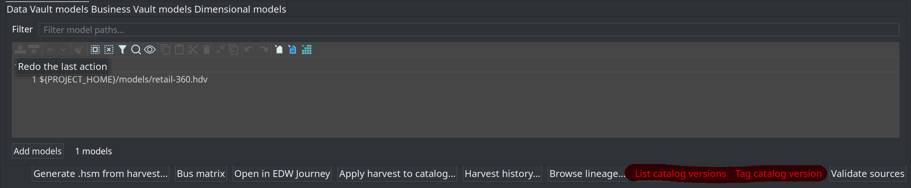
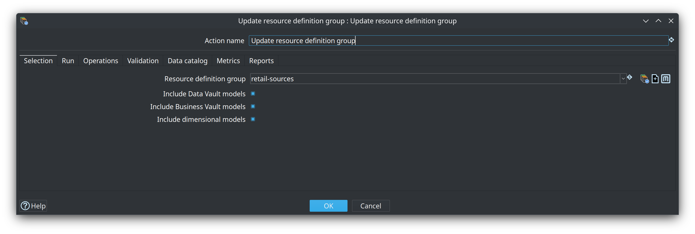
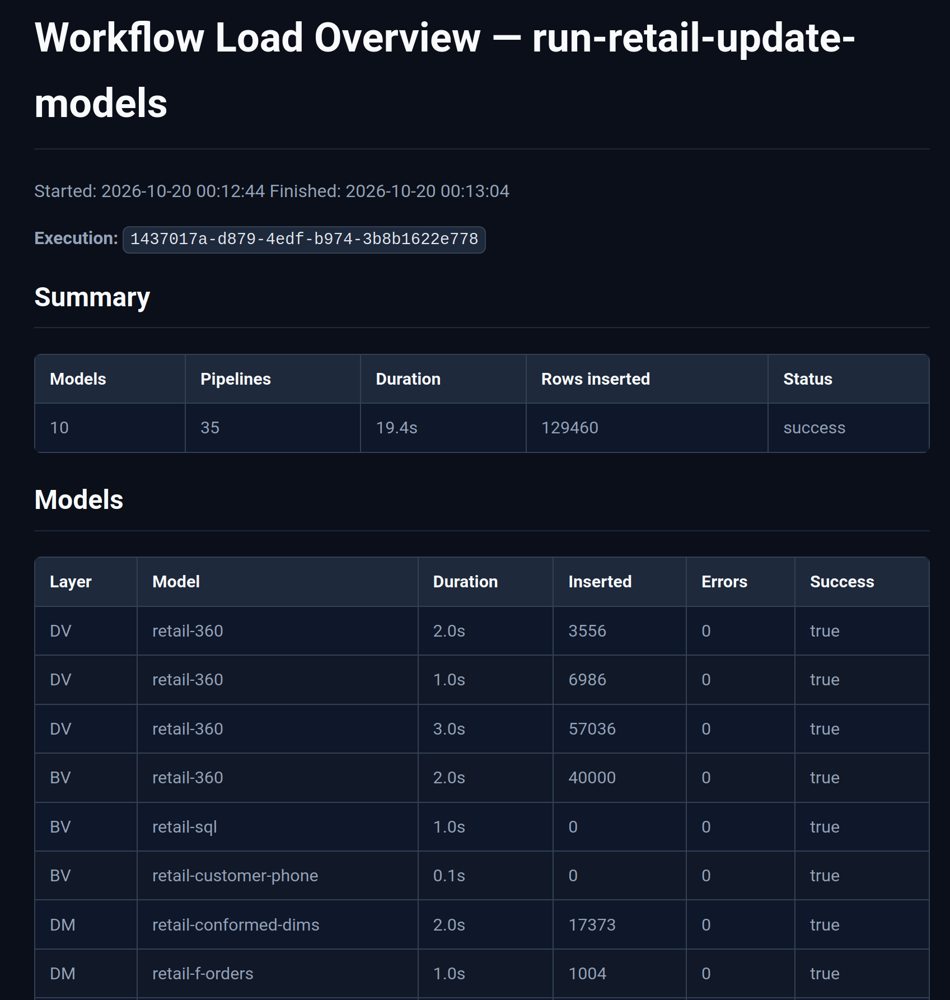

= Module 4 — Loading and resource definition groups
:toc: left
:toclevels: 2
:sectanchors:

++++
<link rel="stylesheet" href="quiz.css" />
++++

== Why it matters

Models describe a warehouse; a load builds it. In Data Hopper EDW the scope of a load is not a file and
not a connection — it is the **resource definition group**: the list of warehouse models one warehouse
consists of. Harvest, schema validation, catalog version tags, and loading all take the group as their
scope.

Without a group, every runnable step needs its own wiring and the schema gate has nothing to compare.
With one group you get one wave: all Data Vault models, then all Business Vault models, then all
dimensional models, with a single load overview at the end.

This module builds on module 3: you need at least one `.hdv` that checks clean, and a database to load
into. Budget 30-40 minutes.

== Concepts

=== The group is the scope of everything that runs

A resource definition group holds the `.hdv` files on its **Data Vault models** tab, the `.hbv` files on
its **Business Vault models** tab, and the `.hdm` files on its **Dimensional models** tab, plus a
**Default catalog connection** — the FILE catalog used when harvest, validate, tag, and the group update
do not override it.

The group is *not* a folder of catalog record definitions. Source feeds live in the catalog, and the
group **points at** the model files that use them; putting catalog JSON paths in a model tab is an
anti-pattern.

Create the group as soon as the first `.hdv` checks clean and leave the Business Vault and dimensional
tabs empty. Actions that take the group as their scope include **Harvest source metadata** (harvests
every catalog source referenced by the listed models), **Validate resource definitions** (the schema
gate), **Update resource definition group** (the load), **Tag catalog version** / **List catalog
versions**, and the lineage and architecture exporters.

=== Group update vs single-model update

**Update resource definition group** is the normal load action once you have a group — including a group
that lists only one `.hdv`. Every model runs through the same update path as the dedicated **Data Vault
Update** / **Business Vault Update** / **Dimensional Update** actions: model check options, DDL policy,
parallel pipeline copies, and optional catalog publish.

A standalone **Data Vault Update** action points at one `.hdv` file. It stays useful for debugging a
single model, and Begin/End Vault Update remain the advanced way to bracket a custom per-model graph.
For a standard multi-layer load, the group action is the shortest correct path.

One behavioural difference to remember: if a listed `.hdv` uses a read-only existing vault
configuration, the group action **skips** that Data Vault job (and logs it) so Business Vault and
dimensional updates still run — a standalone Data Vault Update pointed at the same file fails instead.

=== The load order is fixed

The group update always loads **all Data Vault models first, then all Business Vault models, then all
dimensional models**. Within a layer, the order is the list order of that tab. You cannot interleave
layers by shuffling the three lists; the action's **Selection** tab only turns whole layers on or off
(**Include Data Vault models**, **Include Business Vault models**, **Include dimensional models**).

=== What write-back to the catalog means

With **Publish target tables to catalog** enabled, each successful model write in the wave upserts:

* target table layouts under `models/`, `business-vault/`, or `dimensional/` in the project's catalog;
* lineage siblings under `lineage/`;
* model-registry entries that Business Vault and dimensional tables resolve through `ref('model', 'table')`.

That is why a group update changes the Data Catalog even though you never edited a source feed: the
action publishes *targets*. Your source feeds stay as they are.

=== Watching a load

While the action runs it paints a badge in its bottom-right corner — a clock, a stall warning when no
transform has made progress for about a minute, or a failure. Click the badge (or use **View load
metrics** on the action's context menu) to open **Resource group load metrics**: **This run** lists
every model in the wave with the current table, elapsed time, and live metrics; **History** lists recent
OPS load overviews.

For per-pipeline detail: every model in the wave runs through the same update path as a dedicated
update action, including the orchestrator pipeline that stages and picks up the generated update
pipelines. To see which staged pipelines are being picked up and how many executor copies are busy,
click a running update and choose **Open execution**.

image::../images/open-execution-of-data-vault-update-action.png[Open execution on a running update action,align="center"]

Options that shape the wave: **Update target database structure** (execute CREATE/ALTER DDL before
loading), **Fail if DDL is needed** (the production guard — fail instead of altering), and **Do not
update target database** (dry run: checks and DDL handling only, no data pipelines). On the **Metrics**
tab, **Manage vault update metrics (Begin/End)** assigns `DV_WORKFLOW_EXECUTION_ID` before the models
run and publishes the workflow load overview at the end; Markdown and/or HTML reports land in the report
folder (retail default: `work/reports`).

== Guided walkthrough

=== Start the environment

. From the repository root, start the local PostgreSQL database once (container
`hop-data-vault-postgres-local`, port 54320):
+
[source,sh]
----
./scripts/run-postgres.sh up
----
. Optional but recommended — load the finished retail warehouse once, so you have a complete run to
compare your own work with:
+
[source,sh]
----
./scripts/run-hop.sh retail-example workflows/run-retail-initial.hwf
----
. Open Hop GUI on the project folder `retail-example/` (**File → Open project**).

=== Read the retail group

. Open **Metadata → EDW → Resource definition group** and read `retail-sources`. The **Data Vault
models** tab lists `retail-360.hdv`, the **Business Vault models** tab lists three `.hbv` files, and the
**Dimensional models** tab lists four `.hdm` files. **Default catalog connection** is `local-catalog`.
+
image::../images/resource-definition-group-editor.png[The resource definition group editor for retail-sources,align="center"]

. In the button bar at the bottom of the editor, find **Tag catalog version** and **List catalog
versions** — source-contract snapshots that later schema gates compare against.
+

=== Create a group for your own models

. **Metadata → EDW → Resource definition group → New**.
. Set **Name** (for example, after your project) and keep **Default catalog connection** = `local-catalog`.
. On the **Data Vault models** tab, **Add models** and select the `.hdv` you created in module 3. Keep
the `${PROJECT_HOME}/models/…` form.
. Leave **Business Vault models** and **Dimensional models** empty — those files do not exist yet.
. Save.

=== Configure the update action

. Create a new workflow and add the action **Update resource definition group** (category **General**).
. **Selection** tab: choose your group; leave **Include Data Vault models** on, and turn the Business
Vault and dimensional includes off until those files exist.
. **Operations** tab: enable **Update target database structure** so CREATE TABLE runs on the empty
Vault.
. **Data catalog** tab: enable **Publish target tables to catalog**.
. **Validation** tab: keep the defaults (model checks are logged; abort on errors if you want a hard
stop before loading).
+

=== Run it and check the database

. Run the workflow from the GUI (or with `hop-run` / a Docker runner). Watch the log and the action's
corner badge.
. When the run has finished, confirm the tables exist on the target connection. In the **Database**
perspective, connect **Vault** and expand **Vault → public**:
+
Expected: `hub_*`, `lnk_*` and `sat_*` tables. Select one and press **Preview table** to see rows.
. Compare: every hub, link and satellite table name from your `.hdv` appears in the list.

=== Find what the load published

. Refresh the **Data Catalog** perspective (**F5**) and open the project namespace.
. The model's target layouts now appear under `models/`, next to the source feeds under `sources/`.
Publish writes targets; your source feeds are untouched.

=== Run the retail production wave

. Open `retail-example/workflows/run-retail-update.hwf`, or run it from the repository root:
+
[source,sh]
----
./scripts/run-hop.sh retail-example workflows/run-retail-update.hwf
----
. The wave is the production pattern: **Harvest source metadata → Validate resource definitions (schema
gate) → Measure / Evaluate source quality → Update resource definition group (`retail-sources`)** — the
nested `run-retail-update-models.hwf` — with the load recorded and operational analytics afterwards.
. Open the generated load overview in `retail-example/work/reports/` (base name `retail-dv-update-report`,
Markdown and HTML). It summarizes the wave — model count, pipeline count, total duration, rows inserted
— and lists each model with its duration and row counts:
+

== Try it yourself

Run your own group update a second time without changing anything — an idempotent wave is the goal:

. Run the same workflow again and watch the log.
. Check the database: the tables are still there, the run succeeds, and no table is dropped or recreated.
. Check the catalog: the target layouts and lineage siblings under your project namespace are the same as
after the first run.

Then answer the checkpoint question: which layers did your run include, and what would you have to add
to your group before the same wave could load a Business Vault model?

Expected result: a second successful run with an unchanged warehouse and an unchanged catalog listing. If
you see CREATE/ALTER statements for tables that already look correct, compare the model with the target
database before continuing — something differs between them.

== Questionnaire

Answer the seven questions. Every answer comes with its reasoning, and **Copy my results** gives you a
text summary to keep.

++++

  

    
1. What is a resource definition group?

    

      <button type="button" class="edw-quiz-option">a) The folder of catalog source feeds a warehouse reads</button>
      <button type="button" class="edw-quiz-option" data-correct="true">b) The list of warehouse models one warehouse consists of, plus the default catalog connection</button>
      <button type="button" class="edw-quiz-option">c) The database connections used by the load pipelines</button>
      <button type="button" class="edw-quiz-option">d) A saved copy of the target database schema</button>
    

    
<strong>b)</strong> A group lists the warehouse models — <code>.hdv</code>, <code>.hbv</code> and <code>.hdm</code> files — plus the default catalog connection. Source feeds live in the catalog; the group points at the model files that use them.

  

  

    
2. When a group exists, how does <strong>Update resource definition group</strong> relate to the single-model <strong>Data Vault Update</strong> action?

    

      <button type="button" class="edw-quiz-option">a) They are identical; the group action only picks a file path</button>
      <button type="button" class="edw-quiz-option">b) Data Vault Update always loads DV, BV and DM; the group action only validates</button>
      <button type="button" class="edw-quiz-option" data-correct="true">c) The group action loads every model listed on the group; Data Vault Update loads one .hdv file</button>
      <button type="button" class="edw-quiz-option">d) The group action replaces model checks, so listed models are never validated</button>
    

    
<strong>c)</strong> The group action is the normal load once a group exists — even a group that lists only one <code>.hdv</code>. Each listed model runs through the same update path as the dedicated single-model actions, which stay available for one file.

  

  

    
3. In which order does the group update load the models?

    

      <button type="button" class="edw-quiz-option">a) All dimensional models, then Business Vault, then Data Vault</button>
      <button type="button" class="edw-quiz-option">b) Strict file-name order across the three tabs</button>
      <button type="button" class="edw-quiz-option" data-correct="true">c) All Data Vault models, then all Business Vault models, then all dimensional models</button>
      <button type="button" class="edw-quiz-option">d) The action interleaves the layers to resolve dependencies first</button>
    

    
<strong>c)</strong> The layer order is fixed: all DV, then all BV, then all DM. Within a layer, list order is update order. Shuffling the three lists cannot interleave layers; the action only turns whole layers on or off.

  

  

    
4. What does <strong>Publish target tables to catalog</strong> write after each model update?

    

      <button type="button" class="edw-quiz-option">a) A copy of the source feeds that replaces the working catalog contracts</button>
      <button type="button" class="edw-quiz-option" data-correct="true">b) Target table layouts and lineage siblings, plus model-registry entries used by BV and DM references</button>
      <button type="button" class="edw-quiz-option">c) Only the workflow log of the wave</button>
      <button type="button" class="edw-quiz-option">d) The DDL script that was executed on the target database</button>
    

    
<strong>b)</strong> Each successful model write upserts target layouts under the models, business-vault and dimensional namespaces, lineage siblings under lineage, and registry entries for <code>ref('model', 'table')</code> resolution. The action publishes targets — your source feeds stay as they are.

  

  

    
5. Scenario: a second subject area must load in the same nightly wave as the existing warehouse. What is the right move?

    

      <button type="button" class="edw-quiz-option">a) Create a second resource definition group for the new subject area</button>
      <button type="button" class="edw-quiz-option">b) Create one group per layer — a DV group, a BV group and a DM group</button>
      <button type="button" class="edw-quiz-option" data-correct="true">c) Add the new models to the same group, so one warehouse loads as one wave</button>
      <button type="button" class="edw-quiz-option">d) Leave the new models out of every group and load them with single-model actions</button>
    

    
<strong>c)</strong> One warehouse is one group. Create a second group only when teams need separate load waves; one group per layer is an anti-pattern, and the wave is exactly what the group lists.

  

  

    
6. Why is the group created as soon as the first <code>.hdv</code> checks clean, with the Business Vault and dimensional tabs still empty?

    

      <button type="button" class="edw-quiz-option">a) Because the group file must list every model that will ever exist before the first load runs</button>
      <button type="button" class="edw-quiz-option">b) Because dimensional models cannot be saved without a group</button>
      <button type="button" class="edw-quiz-option">c) Because the catalog rejects source feeds that belong to no group</button>
      <button type="button" class="edw-quiz-option" data-correct="true">d) Because harvest, Validate sources and the load need a scope right away; the empty tabs are filled as models are authored</button>
    

    
<strong>d)</strong> The group makes harvest, the schema gate and the load usable immediately. Business Vault and dimensional files are added to the same group as they are authored, and the update action then loads them in layer order.

  

  

    
7. What does the schema gate (<strong>Validate resource definitions</strong>) add to the wave?

    

      <button type="button" class="edw-quiz-option">a) It replaces model checks, so the update no longer validates anything</button>
      <button type="button" class="edw-quiz-option" data-correct="true">b) A read-only comparison of catalog contracts against live sources, a version tag or a harvest run, before the updates run</button>
      <button type="button" class="edw-quiz-option">c) Automatic creation of missing target tables before the update</button>
      <button type="button" class="edw-quiz-option">d) Automatic tagging of a new catalog version after the load</button>
    

    
<strong>b)</strong> The gate compares expected contracts with what is found (<code>LIVE_SOURCE</code>, <code>WORKING_VS_VERSION</code>, <code>VERSION_VS_VERSION</code> or <code>HARVEST_RUN</code>) before the DV/BV/DM updates run, and it never writes. On a first load, enable <strong>Target tables are created automatically</strong> so expected CREATE is not treated as a defect.

  

++++

++++

++++

== Where to go next

* link:index.adoc[Training index] — the other modules in this curriculum
* link:../resource-definition-group.adoc[Resource definition group] — every tab, field and button of the group editor
* link:../update-resource-definition-group-action.adoc[Update resource definition group action] — the full option reference for the load action
* link:../datavault-update-action.adoc[Data Vault Update action] — the single-model update path
* link:../resource-definition-validation.adoc[Resource definition validation] — the schema gate, compare modes and version tags
* link:../operations.adoc[Operations] — Docker runners, the batch wave, metrics and reports
* link:../getting-started-edw.adoc[Getting started — building an EDW] — chapters 3-5 follow this module end to end
* link:module-5-business-vault.adoc[Module 5 — Business Vault] — next step: add a Business Vault to the same group

'''

[.text-center]
link:index.adoc[← Back to the training index]
