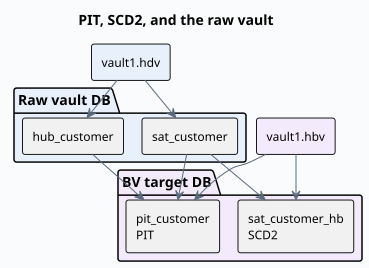
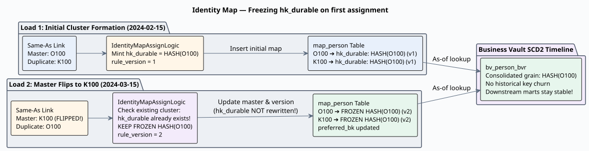
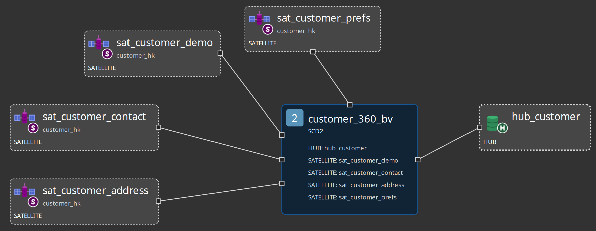
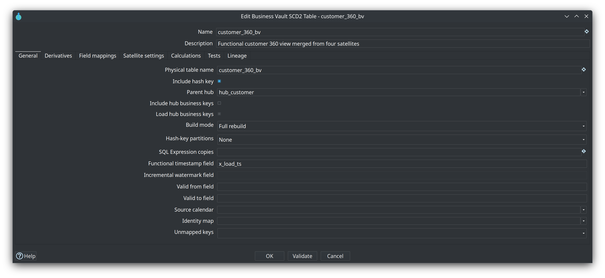
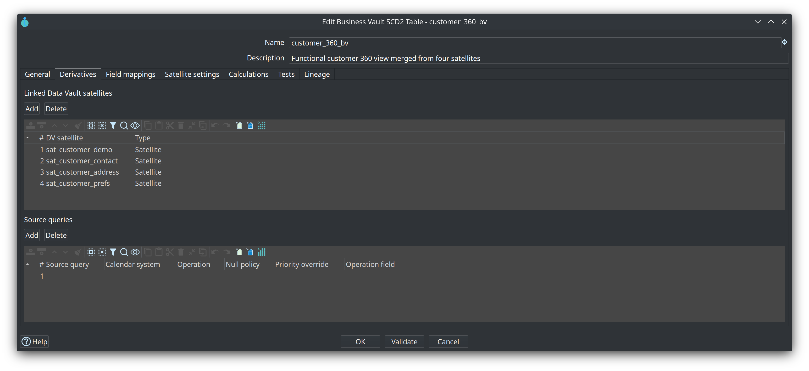
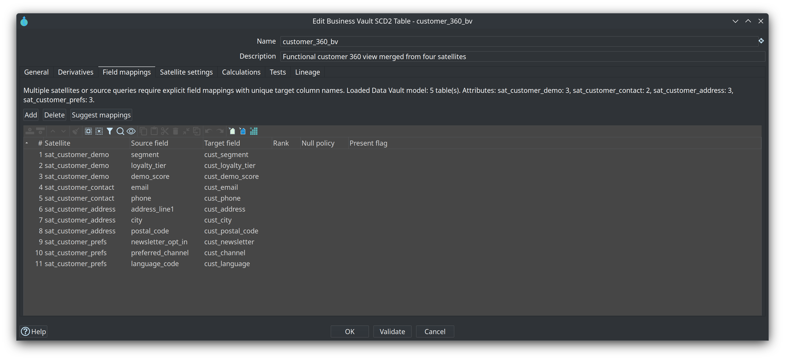
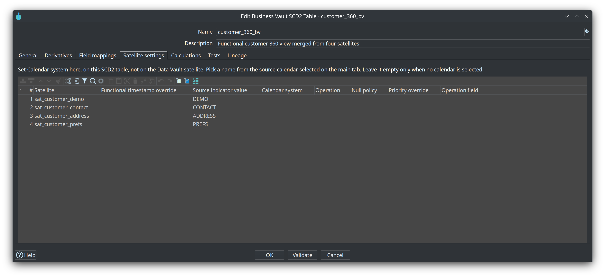

= Module 5 — Business Vault
:toc: left
:toclevels: 2
:sectanchors:

++++
<link rel="stylesheet" href="quiz.css" />
++++

== Why it matters

The raw Data Vault records history: satellites are insert-only, and every row carries the timestamp of
when the warehouse loaded it. That is the right shape for storage, but a poor shape for reading. A
customer timeline exists only as a pile of version rows, and an as-of question has to re-find the row
that was effective at that moment every time it is asked.

The Business Vault is the interpretation layer. It turns satellite history into consumption-ready
tables — effective-dated SCD2 timelines, technical as-of PIT snapshots, bridges — and most of that
work is *generated* from the model rather than written by hand. Get this layer right and every mart
above it inherits clean history and stable keys; skip it and each report re-implements effective-dating
logic on its own.

Prerequisites: the local database is up (`./scripts/run-postgres.sh up`) and the retail warehouse has
been loaded once — `./scripts/run-hop.sh retail-example workflows/run-retail-initial.hwf`. Budget 30-40
minutes. The walkthrough works on `retail-example/` and repeats the same steps on your own models.

== Concepts

=== The interpretation layer

A Business Vault model is an `.hbv` file that references a linked Data Vault model (`.hdv`). It
**reads** hub and satellite history from the Data Vault target database and **writes** its tables to
the Business Vault target database. The two connections are configured separately (the DV one on the
`.hdv`, the BV one on the `.hbv`) and may or may not be the same; both must resolve in the Hop project,
and **Check model** validates that before any pipeline is generated.

=== Choose the table type for the question

[cols="1,3", options="header"]
|===
|Table type |The question it answers

|SCD2 (`BvScd2Table`)
|"What did this customer look like at business time T?" — one functional timeline merged from one or
more satellites, with validity bounds.

|PIT (`BvPitTable`)
|"Which satellite row was effective at technical time T?" — one row per hub key and snapshot date,
with a load-timestamp pointer per satellite.

|Bridge (`BvBridge`)
|"Which customers bought which products?" — two or more hub hash keys, usually taken from a Data Vault
link, flattened for reporting joins. Optional weight.

|SQL view / table (`BvBusinessTable`)
|"Anything else we can express in SQL" — business rules, enrichments and lookups you author on the
canvas, materialized as a view or a table with `ref()` / `source()` dependencies.

|Source query (`BvSourceQuery`)
|A satellite-shaped input that lives outside the Data Vault target (a corrective view on another
database, for example). SCD2 and PIT can read it; Business Vault Update does not load it.

|Identity map (`BvIdentityMap`)
|"Are these two records the same customer?" — a shared raw-hub-hash to durable-hash map for one hub.

|Source calendar (`BvSourceCalendar`)
|"When may each source system contribute rows?" — shared cutover windows. Metadata only: nothing is
created or loaded for it.
|===

Data Vault hubs, links and satellites are referenced on a `.hbv` canvas as **Linked Hub**, **Linked
Link** and **Linked Satellite** cards, so a table names the vault objects it reads.

=== SCD2: functional timelines

An SCD2 table merges satellite history into version rows. Every functional change opens a version with
validity bounds (`valid_from` / `valid_to` by default; the retail project's configuration uses
`x_from_ts` / `x_to_ts`). The **functional timestamp** decides where a version starts — the moment the
source system said the value became true. It resolves in this order: per-satellite override, then the
per-table field, then the model default, then the load-date fallback. The retail 360 model sets it to
`x_load_ts` on the table.

An SCD2 table is **pure Type 2**: a value change becomes a new version row and the older rows stay
queryable. There is deliberately no per-column Type 1 switch that would rewrite historical versions
when a "current" value changes — mixing the two would make some columns look historical while they are
not. When users need a value as it is now (say, the current sales rep on old facts), resolve it
downstream: join the open SCD2 row, read the latest satellite row, use a separate current-state view or
table, or use hybrid Type 1 + Type 2 in the dimensional model.

Field mappings are required when two or more inputs feed one table, and **Suggest mappings** fills the
unmapped attributes of the satellites and source queries you select. On **Satellite settings**, each
satellite can override the functional timestamp, carry a source indicator value (the merge tag used
when several satellites are merged), and name the calendar system it belongs to when a source calendar
is selected.

=== PIT: technical as-of snapshots

A PIT table materializes the as-of lookup once, so consumers join instead of re-deriving it: one row per
`(hub hash key, snapshot date)`, plus one pointer column per satellite (default suffix `_ldts`) holding
the load timestamp of the satellite row that was effective at that snapshot. A query then joins
`sat.x_load_ts = pit.sat_customer_ldts` for the snapshot it wants.

PIT reads **raw** hub and satellite history — not SCD2 output. SCD2 and PIT are independent siblings in
the same run, and SCD2 tables run first. The snapshot spine is a schedule: **Snapshot cadence** (daily
only today; the other cadences validate but cannot be generated yet), **Snapshot anchor** (end of
period by default), **Horizon days** (default 1 — skips the most recent days as a late-arriving-data
buffer), and **Range start** / **Range end** (default: the earliest participating satellite load to
now minus the horizon). A PIT table that already exists only receives snapshot dates newer than its
highest `snapshot_date`.

=== Identity maps and survivorship

An **identity map** resolves many raw hub hashes to one durable hash. Add it with **Add identity map**
(a parent hub and a same-as link are what it needs), and an SCD2 table opts in with **Identity map**;
leave that blank and the timeline keeps the raw hub hash as its grain. The generated map upserts and
never truncates: a raw key that already has a durable key keeps it, so `hk_durable` is frozen on first
assignment and survives the next run. Rows that predate the mapping follow the unmapped policy — `self`
keeps the raw hash, `quarantine` and `drop` leave the row out of the timeline.

**Survivorship** decides values when several sources feed the same target column. Give each of those
mapping rows a **Rank** — `1` wins over `2` — and the merge keeps the best-ranked value at every
timestamp. Null policies decide what a null does (`inherit` skips to the next rank, `apply` writes it).
A table with no ranks keeps the normal merge behaviour.

=== Source calendars

A **source calendar** is shared metadata — not a warehouse table — that says when each source system may
contribute rows. Each entry is a half-open window: a calendar system name you choose (`ORACLE`,
`KAFKA`, …), an effective-from and an effective-to, where an empty effective-to means the source is
still in use. An SCD2 table opts in with **Source calendar** and then names the calendar system per
satellite on **Satellite settings**; leave it blank and every satellite row is kept. The documented
example: Oracle rows count through 2024-02-29, Kafka rows from 2024-03-01.

=== How a Business Vault load runs

**Business Vault Update** (`BUSINESS_VAULT_UPDATE`) mirrors Data Vault Update: model check, optional DDL
on the target, pipeline generation, staging, parallel execution, and optional catalog publish. Within
one run the order is fixed: SCD2 tables, then PIT, then bridges, then SQL business tables. Inside a
full warehouse wave, **Update resource definition group** runs all Data Vault models first, then all
Business Vault models, then all dimensional models — each layer in list order.

**Debug** (toolbar) and **Show build pipeline** (table context menu) generate a build pipeline and open
it without writing any data. That is the fastest way to read what a table will actually do before a
load touches the warehouse.

== Guided walkthrough

=== Read the finished Business Vault

. Open the project folder `retail-example/` in Hop GUI and open **`models/retail-360.hbv`** (or select
it under **4. Business Vault** in the **EDW Journey** perspective).
. Read its tables: `customer_360_bv` is one SCD2 table that merges four satellites —
`sat_customer_demo`, `sat_customer_contact`, `sat_customer_address`, `sat_customer_prefs` — around
`hub_customer`. The model also carries a source calendar (`Oracle-Kafka-Calendar`) and a SQL
calculation (`online_indicator`). The group's Business Vault tab also lists `retail-sql.hbv`, which
materializes `satb_product_hb`, a historical view over `sat_product`.
+

. Open the table dialog (double-click `customer_360_bv`) and walk its tabs: **General** (physical table
name, **Include hash key**, **Include hub business keys**, **Build mode**, validity fields),
**Derivatives** (the hub and the four satellites), **Field mappings**, **Satellite settings** and
**Calculations**.
. Note the interaction model: the canvas uses left-click context menus (there is no right-click menu),
and those menus are where you add your own tables.

=== Build your own SCD2 table

. In your own project, open (or create) a `.hbv` and set **Edit model → Data Vault model file** to your
`.hdv`. On the canvas, place the vault cards you need: **Add Linked Hub** for the hub, then **Add
Linked Satellite** for each satellite that feeds the table.
. **Add SCD2 table**, then set **Parent hub** in the dialog and pick the satellites on the
**Derivatives** tab. On **Field mappings**, press **Suggest mappings** and select the satellites to
fill; keep, rename or drop the proposed target columns.
+

+

. Read the **Field mappings** list: each row maps one satellite attribute to one Business Vault column,
and every mapped attribute is history (Type 2). Pick one attribute you would *want* to be always
current — a loyalty tier, a current sales rep — and note that the plugin keeps SCD2 pure Type 2, so that
value will be resolved downstream instead.
+

. Use **Show build pipeline** on the table to read the generated pipeline: satellite reads, the sorted
merge, the `LAG` / `LEAD` validity computation, and the load into the target. Nothing is written by
opening it.
. Open **Satellite settings** and read the per-satellite overrides: functional timestamp, source
indicator value, and the calendar system used when a source calendar is selected on the table.
+

. Add a PIT table over the same hub: **Add PIT table**, set exactly one hub and at least one satellite
as derivatives, and read the snapshot schedule — **Snapshot cadence**, **Snapshot anchor**, **Horizon
days**, **Range start** and **Range end**.
. **Check model** until it reports no errors.

=== Register and load the model

. Add the `.hbv` to your warehouse: **Metadata → EDW → Resource definition group**, open your group, add
the file on the **Business Vault models** tab and save.
. Run **Update resource definition group** again. The action loads all Data Vault models first, then all
Business Vault models, then all dimensional models, each layer in list order; watch the log for the
SCD2 and PIT pipelines.
. Prove it in the database. In the retail example the SCD2 table is `customer_360_bv`; use the name your
own model generated if you followed the steps on your own vault. In the **Database** perspective,
connect **Vault**, expand **Vault → public**, select the table and press **Show object information**:
+
Expected in the column list: the parent hash key, the hub business keys, the validity columns
(`x_from_ts` / `x_to_ts` in this project), and one column per field mapping. **Preview table** shows the
rows themselves.

== Try it yourself

Take one attribute your SCD2 table will carry that users will always want as it is *now* — a loyalty
tier, a current sales rep — and decide its fate:

. Map the attributes that are history. Every mapped column is Type 2 by design; there is nothing to
mark.
. Write one line: where will the current value come from? (Join the open SCD2 row; read the latest
satellite row; use a separate current-state view or table; or keep the rule for hybrid Type 1 + Type 2
in the dimensional model.)
. Run **Check model** and fix whatever it reports.

Check your work: no model check errors, and your line matches the Type 1 vs Type 2 rule in *Concepts* —
history stays clean Type 2 on the SCD2 table and "current" is resolved downstream. If your note says
"switch the column to Type 1 on the SCD2 table", re-read that section: the plugin deliberately offers no
such switch.

== Questionnaire

Answer the eight questions. Every answer comes with its reasoning, and **Copy my results** gives you a
text summary to keep.

++++

  

    
1. What does the Business Vault add over the raw Data Vault?

    

      <button type="button" class="edw-quiz-option">a) It replaces insert-only satellites with tables you edit in place</button>
      <button type="button" class="edw-quiz-option" data-correct="true">b) It turns satellite history into consumption-ready tables — functional SCD2 timelines and technical as-of PIT helpers — built from the model instead of hand-written SQL</button>
      <button type="button" class="edw-quiz-option">c) It stores the source contracts that used to live in the Data Catalog</button>
      <button type="button" class="edw-quiz-option">d) It removes the need to load the raw vault first</button>
    

    
<strong>b)</strong> The Business Vault reads hub and satellite history from the Data Vault target database and writes its tables to the Business Vault target database. The merge, validity and pointer logic is generated from the <code>.hbv</code> model; only SQL business tables are SQL you author yourself.

  

  

    
2. SCD2 table or SQL view / table — how do you choose?

    

      <button type="button" class="edw-quiz-option">a) SCD2 for arbitrary business SQL; the SQL object for effective-dated history</button>
      <button type="button" class="edw-quiz-option" data-correct="true">b) SCD2 merges satellite history into effective-dated versions from the functional timestamp; a SQL view / table is for SQL you author, materialized with <code>ref()</code> / <code>source()</code> dependencies</button>
      <button type="button" class="edw-quiz-option">c) They store the same rows; only the materialization differs</button>
      <button type="button" class="edw-quiz-option">d) SCD2 works only for hubs that have no satellites</button>
    

    
<strong>b)</strong> SCD2 is the mechanical pattern: collapse history into version rows. SQL business tables are for business rules, enrichments and lookups you must author; Business Vault Update orders and materializes them after the SCD2 and PIT loads. See <a href="../business-vault-sql-view.html">Business Vault SQL views and tables</a>.

  

  

    
3. What does a PIT table solve?

    

      <button type="button" class="edw-quiz-option">a) It merges and deduplicates customers that appear in several source systems</button>
      <button type="button" class="edw-quiz-option" data-correct="true">b) It stores one row per hub hash key and snapshot date with a load-timestamp pointer per satellite, so as-of queries join instead of re-deriving the effective row</button>
      <button type="button" class="edw-quiz-option">c) It keeps only the latest version of every attribute</button>
      <button type="button" class="edw-quiz-option">d) It replaces the raw satellite tables</button>
    

    
<strong>b)</strong> A PIT table materializes the lookup once: join <code>sat.x_load_ts = pit.sat_customer_ldts</code> for the snapshot you want. It reads raw hub and satellite history, not SCD2 output; deciding whether two records are the same customer is the identity map's job.

  

  

    
4. Which statement about Type 1 and Type 2 is correct for a Business Vault SCD2 table?

    

      <button type="button" class="edw-quiz-option">a) Every Type 1 change opens a new version; Type 2 overwrites the old value</button>
      <button type="button" class="edw-quiz-option">b) Type 1 and Type 2 are per-column options on the Field mappings tab</button>
      <button type="button" class="edw-quiz-option" data-correct="true">c) Every functional change becomes a Type 2 version row with validity bounds; there is deliberately no per-column Type 1 switch, and always-current values are resolved downstream</button>
      <button type="button" class="edw-quiz-option">d) Type 2 keeps only the newest version, so history must be read from the satellites</button>
    

    
<strong>c)</strong> SCD2 history stays clean: each functional change is its own version. For a value "as it is now", join the open SCD2 row, read the latest satellite row, use a current-state view or table, or keep hybrid Type 1 + Type 2 for the dimensional model.

  

  

    
5. What does an identity map freeze?

    

      <button type="button" class="edw-quiz-option">a) The load date of every satellite row</button>
      <button type="button" class="edw-quiz-option" data-correct="true">b) A durable hash per customer: many raw hub hashes map to one durable key, and a raw key that already has one keeps it across runs — the map upserts and never truncates</button>
      <button type="button" class="edw-quiz-option">c) The open row of an SCD2 timeline</button>
      <button type="button" class="edw-quiz-option">d) The cutover dates of a source calendar</button>
    

    
<strong>b)</strong> The durable hash is assigned once and sticks; a new duplicate inherits the durable key of its cluster. An SCD2 table opts in with <strong>Identity map</strong>; leaving it blank keeps the raw hub hash as the timeline grain.

  

  

    
6. Scenario: two source systems disagree about a customer's name, and both changes arrive in satellites that one SCD2 table merges. Which Business Vault feature decides the value?

    

      <button type="button" class="edw-quiz-option">a) The source calendar</button>
      <button type="button" class="edw-quiz-option" data-correct="true">b) Rank on the field mappings (survivorship): map both sources to the same target column and give each row a rank — rank 1 wins over rank 2</button>
      <button type="button" class="edw-quiz-option">c) The hash-key partitions on the SCD2 table</button>
      <button type="button" class="edw-quiz-option">d) The PIT snapshot pointers</button>
    

    
<strong>b)</strong> When several sources feed one target column, the ranked merge keeps the best-ranked value at every timestamp. Identity maps decide whether two records are the same customer; ranks decide whose value wins.

  

  

    
7. In which order does the Update resource definition group action load the warehouse models?

    

      <button type="button" class="edw-quiz-option">a) All dimensional models first, then Business Vault, then Data Vault</button>
      <button type="button" class="edw-quiz-option" data-correct="true">b) All Data Vault models, then all Business Vault models, then all dimensional models — each layer in list order</button>
      <button type="button" class="edw-quiz-option">c) Alphabetically, by file name</button>
      <button type="button" class="edw-quiz-option">d) Only the models whose file changed since the last run</button>
    

    
<strong>b)</strong> The group is the scope of the wave: every DV model loads, then every BV model, then every DM model, and the list order inside a layer is the update order. Within one BV model the order is SCD2, then PIT, then bridges, then SQL business tables.

  

  

    
8. What is a source calendar?

    

      <button type="button" class="edw-quiz-option">a) The daily spine of snapshot dates that a PIT table generates</button>
      <button type="button" class="edw-quiz-option" data-correct="true">b) Shared metadata — not a warehouse table — saying when each source system may contribute rows, as half-open windows (calendar system, effective from / to)</button>
      <button type="button" class="edw-quiz-option">c) A date dimension for the dimensional models</button>
      <button type="button" class="edw-quiz-option">d) A schedule of when Business Vault Update is allowed to run</button>
    

    
<strong>b)</strong> An SCD2 table opts in with <strong>Source calendar</strong> and then names the calendar system per satellite on <strong>Satellite settings</strong>; blank keeps every row. The documented example: Oracle rows count through 2024-02-29, Kafka rows from 2024-03-01.

  

++++

++++

++++

== Where to go next

* link:index.adoc[Training index] — all modules and the learning paths
* link:../business-vault-overview.adoc[Business Vault overview] — every table type on one page
* link:../business-vault-scd2.adoc[Business Vault SCD2] — field mappings, satellite settings, identity maps, survivorship, source calendars, build modes
* link:../business-vault-pit.adoc[Business Vault PIT] — snapshot schedule, pointer columns and current limits
* link:../business-vault-bridge.adoc[Business Vault bridge tables] — multi-hub-key tables for reporting joins
* link:../business-vault-sql-view.adoc[Business Vault SQL views and tables] — authoring SQL with `ref()` / `source()`
* link:../business-vault-update-action.adoc[Business Vault Update action] — every option of the workflow action
* link:../business-vault-configuration.adoc[Business Vault configuration] — target database, sentinels and SCD2 defaults
* link:../dv-integration-modes.adoc[Data Vault integration modes] — when the raw vault is loaded outside Hop
* link:module-6-dimensional-models.adoc[Module 6 — Dimensional models] — next step: facts, dimensions and the bus matrix

'''

[.text-center]
link:index.adoc[← Back to the training index]
