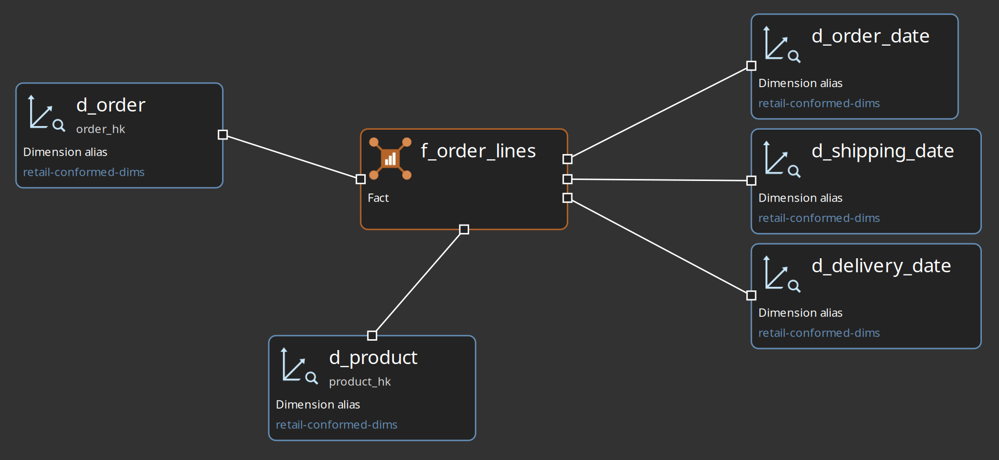
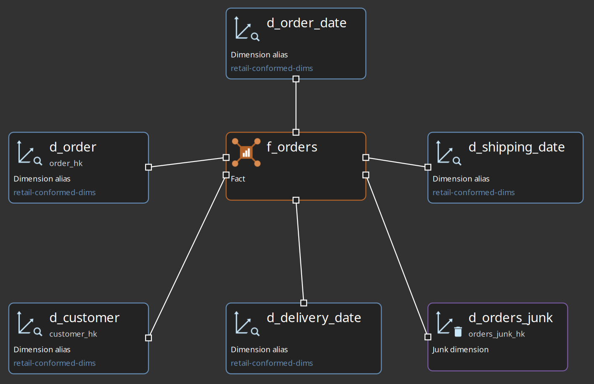
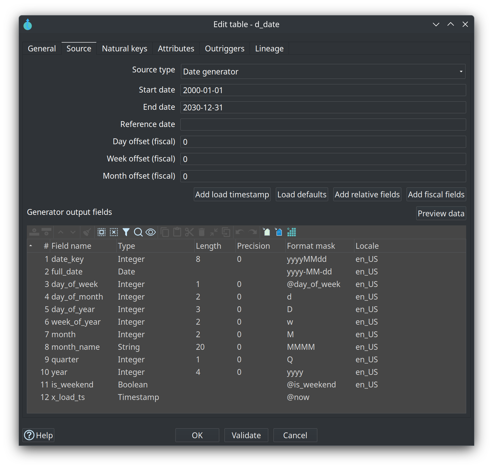
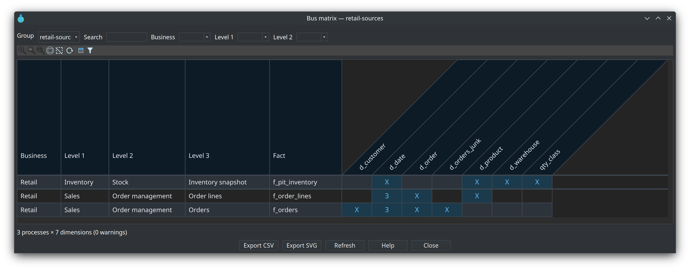

= Module 6 — Dimensional models
:toc: left
:toclevels: 2
:sectanchors:

++++
<link rel="stylesheet" href="quiz.css" />
++++

== Why it matters

Dimensional marts are the layer people actually query. Data Hopper EDW adds Kimball star and
snowflake modeling to Hop: a `.hdm` file describes dimensions, facts, grains, measures and SCD
policies, and the plugin generates and runs the load pipelines for them — the same model-first way
the vault layers are built.

Generation removes the manual work, but it cannot make two modelling decisions for you: the **grain**
of every fact and the **conformed dimensions** that facts share. Get them wrong and every report on
the mart quietly inherits the mistake; get them right and the mart is reproducible from the same
vault that feeds it. Budget 30-40 minutes.

== Concepts

=== A fact states a grain; a dimension carries attributes

A dimensional model is one `.hdm` file: configuration (target database, standard column names such
as `dim_key`, `date_from`, `date_to`), tables, a **conformed dimension registry**, and notes. The
table types cover the whole Kimball toolbox: dimensions (SCD1, SCD2 or SCD3), transaction facts, junk
dimensions, bridges, factless facts, periodic and accumulating snapshots, and aggregates.

Every fact states a **grain** — what one row represents. The retail models say it out loud:
`f_orders` is grain `order`, `f_order_lines` is grain `order-line`, and `f_pit_inventory` is grain
`warehouse-product-day`. At load time the fact resolves each dimension role with a dimension lookup;
junk dimensions are built with a combination lookup, bridges carry many-to-many weights, and factless
facts carry dimension foreign keys only.

Dimensions carry a natural key and attributes with per-attribute policies (Type 1 / Type 2), and the
modeler generates the matching pattern: Insert/Update for Type 1, a merge chain for SCD2, a Dimension
Lookup with update for hybrid Type 3. Surrogate keys are generated by default and can be overridden
per dimension — the retail dimensions use the Data Vault hash keys (`customer_hk`, `order_hk`,
`product_hk`) straight from the vault. **Check model** runs the Kimball validation: grains, roles,
source SQL, references.

=== Conformed dimensions and role-playing dates

One physical dimension table shared by several facts is what *conformed* means: every fact joins the
same `d_customer`, so their reports agree about the customer. The retail project keeps its shared
dimensions in `retail-conformed-dims.hdm` — `d_customer`, `d_order`, `d_product`, `d_warehouse` and
the calendar `d_date` — and the fact models reference them as dimension aliases instead of rebuilding
them.

Role-playing dates are the same idea inside one star: `d_order_date`, `d_shipping_date` and
`d_delivery_date` are three roles of the single physical `d_date`. The `f_order_lines` canvas shows
both ideas at once — conformed dimension aliases and three date roles on one fact:

=== The date dimension is generated

A dimension can get its rows from a **Date generator** source instead of SQL: the model embeds the
Date Dimension Generator transform in the generated load pipeline, so the standard calendar needs no
external pipeline at all. The retail `d_date` covers `2000-01-01` to `2030-12-31` and emits one row
per day, with the standard field pack (`date_key`, `full_date`, `day_of_week`, …) plus a load
timestamp (`x_load_ts`); it loads with **Type 1 — skip unchanged**, which sends only new and changed
calendar rows to the table.

=== The bus matrix is the conformance map

The **bus matrix** is a crosstab of business processes (facts) against conformed dimensions, built
from every `.hdm` file listed on the resource definition group. Facts are tagged on their General tab
with **Business** and **Process level 1 / 2 / 3** from a business process catalog — the retail
catalog is `retail-bus`. Role-playing date aliases collapse into the physical `d_date`, and a cell
can show a role count instead of a single mark. An empty column is a coverage gap: a dimension no
process uses yet.

=== Publish a draft, then update

Two workflow actions cover the layer. **Dimensional Publish** converts a `.hdv` into a **draft**
`.hdm` for human review — hub to dimension, satellite to attributes (SCD2 when historized), link to
bridge or factless fact — and runs no ETL; the GUI equivalent is **Publish draft dimensional model**
on the `.hdv` canvas. **Dimensional Update** is the load: it runs the model check, skips tables whose
source is **None (logical)** (contracts, not loads), optionally generates CREATE TABLE DDL and lookup
indexes on the target database, generates one pipeline per table from native Hop transforms, and
runs them through the parallel orchestrator. A table needs a complete source configuration — SQL,
pipeline, record definition or date generator — before the update will run it.

== Guided walkthrough

=== Open the finished marts

. Start Hop GUI and open the project folder `retail-example/` (**File → Open project**), then open
`models/retail-f-orders.hdm` in the modeler. The canvas holds the fact `f_orders`, its dimensions
(`d_customer`, `d_order`, the junk dimension `d_orders_junk`) and three date aliases that all point
at the single `d_date`: `d_order_date`, `d_shipping_date`, `d_delivery_date`.
+

. Open the fact `f_orders` and read it: the grain is `order`, `total_amount` is the measure, and
`degenerate_info` is a degenerate attribute. Its **Source** tab shows where the rows come from — SQL
against the raw vault in the `Vault` database (`hub_order`, `hub_customer`, `sat_order`,
`lnk_order`). Its **General** tab is where the business process tags live.

. Open `models/retail-f-order-lines.hdm` to see the same pattern one grain finer: `f_order_lines`
has grain `order-line`, reuses the conformed dimensions from `retail-conformed-dims.hdm`, and points
the same calendar `d_date` at three roles.
+

. Open `models/retail-conformed-dims.hdm` and select `d_date`. On the **Source** tab the source type
is **Date generator**: range `2000-01-01` to `2030-12-31`, the standard field pack plus the load
timestamp `x_load_ts`, and load strategy **Type 1 — skip unchanged**.
+

. On the dimensional canvas, left-click the background: the context menu offers **Add date
dimension**, which creates its own `dim_date`/`d_date` with source type **Date generator** and the
default field pack. **Load defaults**, **Add relative fields**, **Add fiscal fields**, **Add load
timestamp** and **Preview data** manage that pack from the Source tab.

. In your own project from modules 2-5, add a fact over your hub and its satellite: state the grain
explicitly, map one foreign key per dimension role, and pick the measures.

. **Check model** until the Kimball validation is clean. A table still on source type **None
(logical)** is a contract only: the check warns and Dimensional Update skips it.

. Add the `.hdm` to the **Dimensional models** tab of your resource definition group and run the
group update (**Update resource definition group**). With **Update target database structure** on,
the run creates the tables and their lookup indexes; the action always loads all DV, then all BV,
then all DM, in list order.

. Tag each fact on its **General** tab — **Business** and **Process level 1 / 2 / 3** from metadata
`retail-bus` — and open the bus matrix from the resource definition group editor (**Bus matrix**) or
**Tools → View bus matrix…**. Rows are business processes, columns are conformed dimensions; the
date aliases collapse into `d_date` and the cell shows a role count.
+

. Query a loaded fact on the `Vault` connection to prove the grain — in the **Database** perspective,
**Open SQL editor** on **Vault**, then **Run** (`Ctrl+Enter`):
+
[source,sql]
----
select count(*) from f_orders;
----
+
One row per order — the grain you read on the fact in step 2, now in the database.

== Try it yourself

Add one degenerate attribute and one new dimension to your own star:

. On your fact from the walkthrough, add a degenerate attribute — a text field carried straight from
the source, like `degenerate_info` on `f_orders`.
. Add a new dimension with a natural key and one Type 1 attribute, point a dimension role on the
fact at it, and register it in the model's conformed dimension registry (logical name to physical
table).
. **Check model**, then re-run the group update so the dimension is created and loaded.

Check your work: no model check errors, the fact still loads, and the bus matrix for your group
shows your fact against the new dimension next to the existing ones — if the fact's row is missing,
give it a **Business** / process level tag first. The new table is in the tree too: in the
**Database** perspective, **Vault → public** lists it next to the other marts. To read the fact's
columns instead of its rows, select it and press **Show object information**.

If you have not built your own models yet, do the reading version instead: write down the grain, the
measures and the three date roles of `f_order_lines`, then find its row in the retail bus matrix and
read the cell for `d_date`.

== Questionnaire

Answer the seven questions. Every answer comes with its reasoning, and **Copy my results** gives you
a text summary to keep.

++++

  

    
1. What does the grain of a fact state?

    

      <button type="button" class="edw-quiz-option">a) How many rows the fact table may contain</button>
      <button type="button" class="edw-quiz-option" data-correct="true">b) What one row represents — the level of detail every measure and role must be true at</button>
      <button type="button" class="edw-quiz-option">c) Which resource definition group the fact belongs to</button>
      <button type="button" class="edw-quiz-option">d) The order in which the fact's dimensions are loaded</button>
    

    
<strong>b)</strong> The retail models write it down: <code>f_orders</code> is grain <code>order</code>, <code>f_order_lines</code> is grain <code>order-line</code>, <code>f_pit_inventory</code> is grain <code>warehouse-product-day</code>. Set it before mapping roles and measures.

  

  

    
2. What makes a dimension conformed?

    

      <button type="button" class="edw-quiz-option">a) It is loaded before every fact</button>
      <button type="button" class="edw-quiz-option">b) It lives in its own dedicated model file</button>
      <button type="button" class="edw-quiz-option" data-correct="true">c) Several facts share one physical dimension table for that subject, so they agree on its attributes</button>
      <button type="button" class="edw-quiz-option">d) It contains no Type 2 attributes</button>
    

    
<strong>c)</strong> Conformance is one physical table loaded once. <code>retail-conformed-dims.hdm</code> holds <code>d_customer</code>, <code>d_order</code>, <code>d_product</code>, <code>d_warehouse</code> and <code>d_date</code>; the fact models reference them instead of rebuilding them.

  

  

    
3. What does the bus matrix show?

    

      <button type="button" class="edw-quiz-option">a) The order in which load pipelines run</button>
      <button type="button" class="edw-quiz-option" data-correct="true">b) Business processes (facts) against conformed dimensions, for the models on a resource definition group</button>
      <button type="button" class="edw-quiz-option">c) Every column of every fact table</button>
      <button type="button" class="edw-quiz-option">d) The field-level lineage of one table</button>
    

    
<strong>b)</strong> It is built from every <code>.hdm</code> listed on the group. Facts are tagged Business / process level 1-3 from a business process catalog, role-playing date aliases collapse into the physical <code>d_date</code>, and an empty column is a coverage gap. See <a href="../bus-matrix.html">Kimball bus matrix</a>.

  

  

    
4. Where does the retail <code>d_date</code> calendar come from?

    

      <button type="button" class="edw-quiz-option">a) A hand-written SQL script in the repository</button>
      <button type="button" class="edw-quiz-option">b) An external pipeline file the model points at</button>
      <button type="button" class="edw-quiz-option" data-correct="true">c) The Date generator source: the model embeds the Date Dimension Generator transform in the generated load pipeline</button>
      <button type="button" class="edw-quiz-option">d) It is copied once from the CRM source system</button>
    

    
<strong>c)</strong> One row per calendar day between the start and end date, with a field table instead of SQL. Retail uses 2000-01-01 through 2030-12-31, the standard field pack plus <code>x_load_ts</code>, and load strategy <strong>Type 1 — skip unchanged</strong>, so a later run writes only new and changed rows.

  

  

    
5. Scenario: <code>f_orders</code> and <code>f_order_lines</code> must report the same customer attributes. What keeps the two facts in agreement?

    

      <button type="button" class="edw-quiz-option">a) Both copy the same staging SQL</button>
      <button type="button" class="edw-quiz-option" data-correct="true">b) Both resolve the customer role against the same conformed <code>d_customer</code> dimension</button>
      <button type="button" class="edw-quiz-option">c) The group update reconciles their rows after every load</button>
      <button type="button" class="edw-quiz-option">d) The bus matrix rewrites one fact to match the other</button>
    

    
<strong>b)</strong> Conformance is a shared physical table: <code>d_customer</code> is loaded once from the vault and both facts carry a foreign key to it, resolved by a dimension lookup at load time.

  

  

    
6. How do Dimensional Publish and Dimensional Update differ?

    

      <button type="button" class="edw-quiz-option">a) Publish runs the loads; Update only drafts the model</button>
      <button type="button" class="edw-quiz-option" data-correct="true">b) Publish converts a <code>.hdv</code> into a draft <code>.hdm</code> for review and runs no ETL; Update validates the model, generates the load pipelines and runs them</button>
      <button type="button" class="edw-quiz-option">c) They are two names for the same workflow action</button>
      <button type="button" class="edw-quiz-option">d) Publish creates the target tables; Update never touches DDL</button>
    

    
<strong>b)</strong> The draft follows starting rules — hub to dimension, link to bridge or factless fact, link satellite with measures to fact — and you review it in the modeler first. Update also has the optional <strong>Update target database structure</strong> step that creates tables and lookup indexes.

  

  

    
7. Where does a dimensional mart read its rows from?

    

      <button type="button" class="edw-quiz-option">a) Always from the raw Data Vault only</button>
      <button type="button" class="edw-quiz-option">b) Always from the Business Vault only</button>
      <button type="button" class="edw-quiz-option" data-correct="true">c) Wherever the table's source configuration points — retail <code>f_orders</code> reads raw vault tables while <code>d_customer</code> reads the Business Vault table <code>customer_360_bv</code></button>
      <button type="button" class="edw-quiz-option">d) Directly from the CRM source files</button>
    

    
<strong>c)</strong> Sources are per table: Database/SQL, a Hop pipeline, a catalog record definition, or the date generator. What matters is that the source delivers rows at the stated grain — raw vault, Business Vault or both.

  

++++

++++

++++

== Where to go next

* link:../dimensional-modeler-overview.adoc[Dimensional modeler overview] — table types, staging sources, pipeline generation strategy, DDL options
* link:../date-dimension-generator.adoc[Date Dimension Generator] — format masks, field packs, relative and fiscal attributes
* link:../bus-matrix.adoc[Kimball bus matrix] — tagging facts, the viewers, CSV/SVG export and the CLI
* link:../dimensional-update-action.adoc[Dimensional Update and Publish actions] — the two workflow actions, option by option
* link:module-7-lineage-quality-operations.adoc[Module 7 — Lineage, quality and operations] — next step
* link:index.adoc[Training index] — all modules and the training environment

'''

[.text-center]
link:index.adoc[← Back to the training index]
