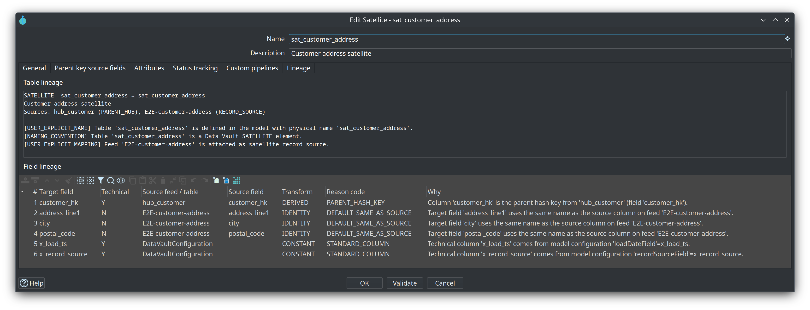
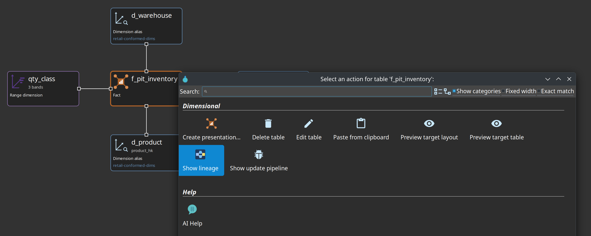
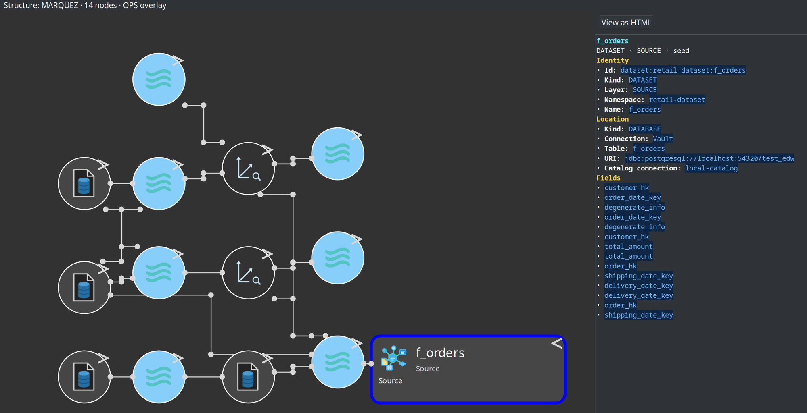
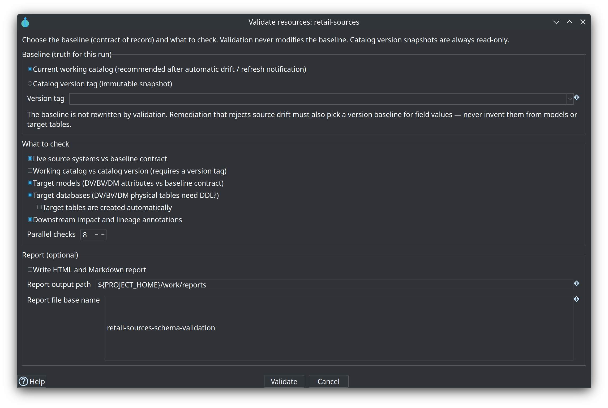
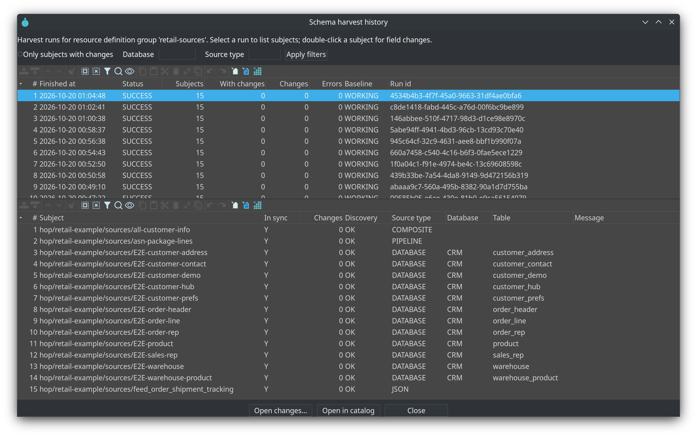
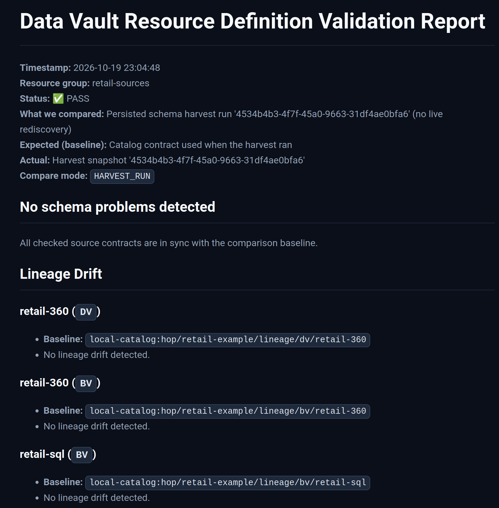
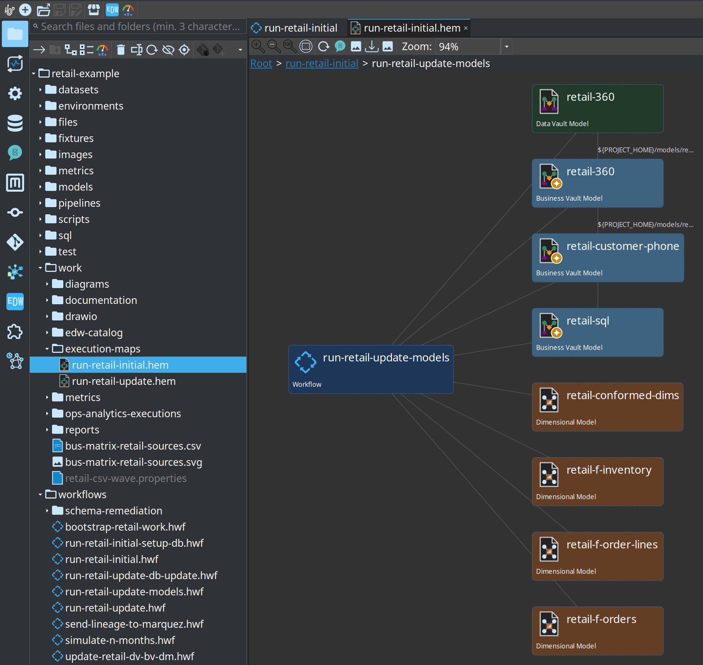
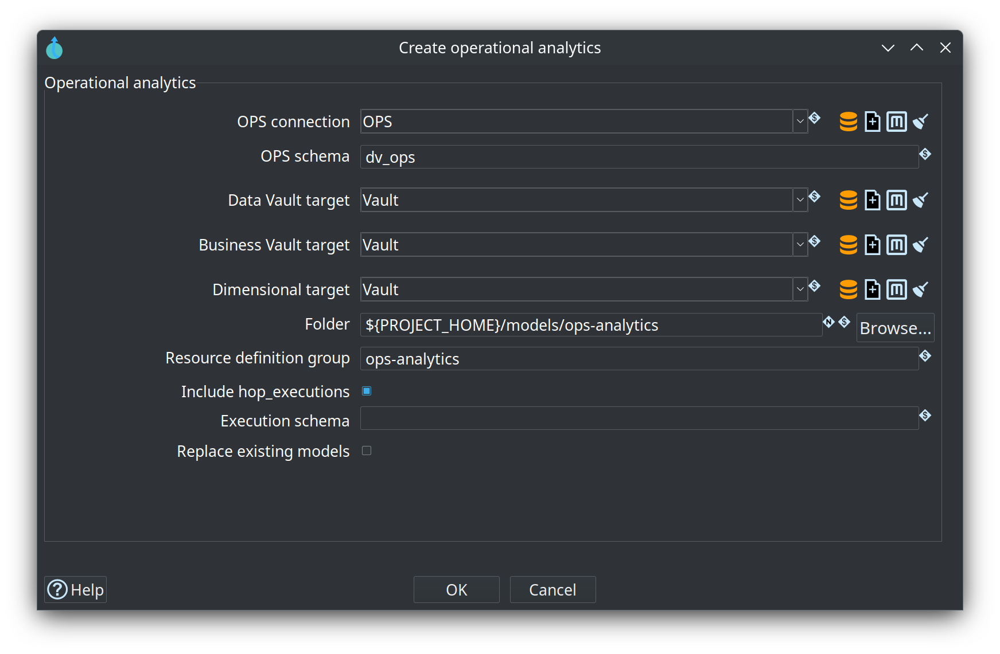
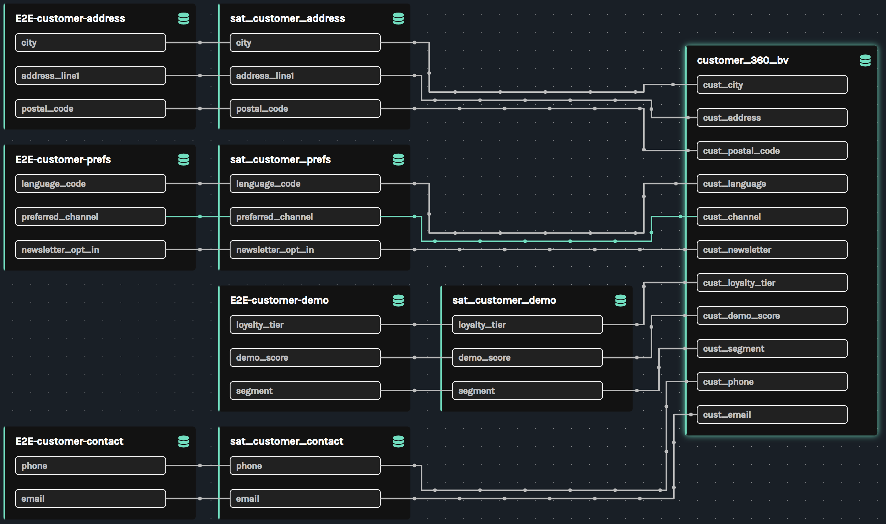

= Module 7 — Lineage, quality and operations
:toc: left
:toclevels: 2
:sectanchors:

++++
<link rel="stylesheet" href="quiz.css" />
++++

== Why it matters

A warehouse that cannot explain itself is not trusted. Three questions come back in every review of a
running EDW: *where did this value come from*, *is the data good enough to load*, and *what ran last
night*. Data Hopper EDW answers each one with a different surface, and mixing them up leads to the
wrong fix — widening a model to silence a content problem, or re-running a load that a schema gate had
already rejected.

This module is the operational view of the four controls you met in module 0. It shows where lineage,
quality, the schema gate and operations live, what each one compares, and how the retail example wires
them into a single update wave. Managers and architects can read it beside module 0: those two modules
are the path that explains the layers, the build order and where the controls sit. Budget 30-40
minutes; the steps that need Docker are marked optional.

== Concepts

=== Three questions, three surfaces

*Lineage* answers where a value came from: which catalog feed or parent table feeds each target table
and field, and why each mapping exists. *Quality* answers whether the rows are good enough, with rules
that measure and a gate that decides. *Operations* answers what actually ran: how the batch is wired,
what each run did, how long it took, and the history behind those numbers.

image::../images/diagrams/d5-four-controls.svg[The four controls and the questions they answer,align="center"]

Module 0 named the four controls: **Check model** (build time), **metadata harvest** (live schema), the
**schema gate** (contract policy) and **data quality** (row content). This module goes deep on the last
three, and on the lineage and operations surfaces around them.

=== Lineage is derived from the models

The `.hdv` / `.hbv` / `.hdm` model files stay the source of truth for loads and DDL. Lineage is a
deterministic projection of those models plus catalog source resolution — not a second place to edit
mappings. For every target table the collectors record the upstream sources (catalog feeds, parent hubs
or links, staging SQL) and the reasons the table and its names exist. For every target column they
record the source contributions, the transform (`IDENTITY`, `RENAME`, `HASH_INPUT`, `DERIVED`,
`CONSTANT`), and reason codes with human-readable text.

The same explanation makes DDL operable. When an update action needs structural changes, or when
**Fail if DDL is needed** stops a load, the log says which table or column would change and which model
mapping forces it — the gate no longer says only "DDL is required", it says why.

=== Where lineage surfaces

[cols="1,3", options="header"]
|===
|Surface |What it gives you

|Lineage tab
|One table in one model: table sources and reasons, then a read-only field grid of target field, technical flag, source feed/table, source field, transform, reason code and the *Why* message.

|Reverse lineage browser
|**Browse lineage…** on the resource definition group: filter by source feed or source field and list every DV/BV/DM consumer with its hop count, target field and transform.

|Catalog lineage siblings
|When a model publishes target layouts, lineage payloads are written into the project's lineage namespace in the catalog — used for discovery and for the drift gate.

|Hop Lineage View (`.hlv`)
|A cross-model, usually upstream graph, queried live from a **lineage backend**. The file stores the backend name, seed, depth, direction and filters; the graph itself is not stored.

|OpenLineage export
|The same collectors serialized as `RunEvent` documents — posted to Marquez or another OpenLineage endpoint, or written to a folder.
|===

An **execution map** (`.hem`) is a different graph: it captures how the batch is wired and what ran, not
how fields map.

=== The lineage drift gate

The **Validate resource definitions** action — and the interactive **Validate sources** on a resource
definition group — also compares current model lineage with the last lineage published to the catalog.
A physical table rename without an explicit name is blocking; a field rename, a mapping change or a
removal is a warning; an addition is info. The validation report carries a **Lineage Drift** section per
model, and a blocking rename can raise the overall status to critical.

=== Quality: measure, then dispose

Data quality is a reusable **measure → disposition** stack, deliberately separate from schema
validation: it checks row content (counts, domains, ranges, nulls, patterns, custom SQL asserts), not
contracts.

* **Measure Data Quality** runs the rules against catalog subjects, logs a formatted report, and can
  persist run, profile and finding history to the OPS database. On rule findings it does **not** fail
  the workflow — only on infrastructure errors, so the findings can always be read.
* **Evaluate Quality Gate** applies policy to that report: `FAIL_ON_BLOCKING`, `FAIL_ON_WARNINGS`, or
  `ALERT_ONLY`, with optional alert sinks (`log`, `ops_table`).

Rules live in **Data quality rule set** metadata — the retail example ships `retail-source-quality` and
`retail-target-quality` — and are bound on catalog record definitions, by library reference or inline.
Before a load, measure the sources and gate with `FAIL_ON_BLOCKING` to stop bad extracts. After a load,
measure the published vault tables and alert with `ALERT_ONLY`: a post-load check observes, and cannot
un-load. Run facts land in the `quality_*` OPS tables, which operational analytics reads later.

=== Harvest observes; the schema gate decides

Two controls work on schemas, and each has one job:

* **Harvest source metadata** *observes*. It rediscovers live source schemas, compares them to the
  catalog (or to a catalog version tag), and persists snapshots and drift into the `schema_harvest_*`
  OPS tables. It is connection-batched, it never rewrites the catalog, and drift does not fail the
  harvest.
* **Validate resource definitions** *decides*. It applies a failure policy to one comparison: expected
  contracts on one side, actual schemas on the other. The compare mode chooses that pair —
  `LIVE_SOURCE` (live discovery), `WORKING_VS_VERSION` (the working catalog against a frozen tag such as
  `v1.0.0`), `VERSION_VS_VERSION` (two frozen tags), and `HARVEST_RUN` (rebuild the report from the
  persisted harvest, with no second discovery).

The recommended chain is Harvest → Validate → quality → update. Both steps write Markdown and HTML
reports under `work/reports/`, and the gate report restates the resource group, the baseline, the
compare mode and the status.

=== Operations: what ran, and for how long

* The **execution map** (`.hem`) is a crawled graph from a root workflow or a model: nested workflows,
  generated pipelines, the models a group update covers, and source datasets resolved from the catalog.
  It stores node positions and a crawl timestamp, so it opens with the same layout; re-crawl after
  model or workflow changes.
* The **OPS database** holds the run facts: load pipeline metrics, workflow load overviews, quality
  history and harvest history. The retail update wave also writes a load overview report per run and a
  metrics file per pipeline run.
* **Operational analytics** turns that database into a warehouse of the warehouse — source model, raw
  vault, Business Vault, a star with twelve facts, and initial and incremental workflows — so "what ran
  last night" is a query, not a log search.
* On a **Hop Lineage View**, duration badges come from OPS, never from the Marquez latest run: an export
  is not a load.

== Guided walkthrough

=== Read lineage from a model table

. Open the `retail-example` project in Hop GUI (**File → Open project**) and open `models/retail-360.hdv`.
. Double-click a satellite — for example `sat_customer_address` — and select the **Lineage** tab. The
**Table lineage** area lists the physical name, the attached sources (the parent hub and the catalog
feed) and the reasons; the **Field lineage** grid maps every target field to its source feed, source
field, transform, reason code and *Why* message.
+

. Right-click a table card and choose **Show lineage** in the action dialog: a Hop Lineage View tab
opens, seeded on the selected table and left unsaved, so you can walk upstream without leaving the
model.
+

=== Walk a Hop Lineage View

. Open `models/f_orders-upstream.hlv`. Its seed is the dimensional fact `f_orders` and its backend is
`Marquez-Localhost`. The status line above the graph names the structure source, the node count and
whether the OPS overlay is on.
. Click a node name to select it: the right-hand pane renders that node as Markdown (identity, location
facets, columns) with a **View as HTML** button, while a click on the rest of the card opens the context
menu (**Open model**, **Open in catalog**, **Show update pipeline**, **Show build pipeline**).
+

. If the canvas is empty, the export has not run. Optional, with Docker: `./scripts/run-marquez.sh up`,
then `./scripts/run-hop.sh retail-example workflows/send-lineage-to-marquez.hwf`, then **Refresh
lineage**.
. Keep the distinction in mind: Marquez holds *structure* derived from the export, while the duration
badges come from the Hop OPS database. Marquez's latest run is the export, not the load.

=== Run the gates and read the reports

. Open **Metadata → EDW → Resource definition group** and select `retail-sources`. The bottom bar
carries the harvest buttons, **Browse lineage…**, the catalog version buttons and **Validate sources**.
. Press **Validate sources** and read the options dialog before running anything: **Baseline (truth for
this run)** is the current working catalog or a catalog version tag such as `v1.0.0`; **What to check**
covers live source systems, the working catalog against a version, target models, target databases (DDL
needed?) and downstream impact; the remaining fields set parallelism and an optional report. Close the
dialog with **Cancel**.
+

. Press **Harvest history…** to browse the persisted harvests for the group: the upper table lists runs
with status, subject and change counts, baseline and run id; the lower table lists the subjects of the
selected run with their discovery status, source type, database and table, and **Open changes…** drills
into field-level changes.
+

. Read the two rule sets shipped with the project:
`retail-example/metadata/data-quality-rule-set/retail-source-quality.json` and
`retail-target-quality.json`. Then find one binding in the **Data catalog** perspective: open an `E2E-*`
source and read its **Quality** tab, which shows the rule set, the rule id and any field or severity
override.
. Run the update wave (optional, Docker; start the local database first with
`./scripts/run-postgres.sh up`): `./scripts/run-hop.sh retail-example workflows/run-retail-update.hwf`.
It checks the database connections and refreshes the source data, then calls the models sub-workflow,
whose order is **Harvest source metadata** → **Validate resource definitions** (the schema gate on group
`retail-sources`) → **Measure source data quality** → **Evaluate source quality gate** → **Update
resource definition group**; after the update it runs **Measure target data quality (post)** and
**Alert on target quality (post)**, and the group update also triggers **Export data lineage to
Marquez**. The wave then runs operational analytics, records the load and exports the architecture.
. Open `retail-example/work/reports/retail-schema-validation.md` and its `.html` sibling: the schema
gate report, with the resource group, the target catalog version, the compare mode and the status, the
issue table, and a **Lineage Drift** section per model.
+

. Open `retail-example/work/reports/retail-dv-update-report.md`: the load overview of that run — the
models and pipelines that ran, the total duration, the rows inserted and the per-model status, with a
section per layer and model.
. Open `retail-example/work/reports/retail-dv-initial-report.md` if you also ran the initial wave; it
has the same shape for the first load.

=== Operations: maps, metrics and a warehouse of the warehouse

. Under `retail-example/work/execution-maps/`, open a crawl — for example `run-retail-update.hem` — in
Hop GUI. A breadcrumb shows the path the crawler took, and the canvas draws the workflow node together
with the models it covers and the pipelines it can reach.
+

. Remember the crawler's limits: expanding an **Update resource definition group** node needs that
group's metadata, and generated pipeline nodes go stale until you re-crawl after a model or workflow
change.
. Look at `retail-example/work/metrics/`: one JSON file per pipeline run, written by the run itself.
These are the measurements behind the load overview report and the OPS tables.
. Optional (GUI): press **Create operational analytics...** on the EDW Journey toolbar and read the
dialog — OPS connection, OPS schema `dv_ops`, the three target connections, the folder, the resource
group and **Include hop_executions**. The retail project already ships the generated stack under
`models/ops-analytics/`, so this dialog is for your own project.
+

. Optional (Docker): with Marquez up and the export done, open `http://localhost:3001` and inspect
column-level lineage — how columns of the `E2E-*` feeds flow through satellites into the Business Vault
table `customer_360_bv`.
+

== Try it yourself

Take one data quality rule and decide whether it should **measure** or **gate** the load. Work only with
the shipped retail material.

. In the **Data catalog** perspective, open one `E2E-*` source that feeds `retail-360.hdv` — for example
the customer address feed behind `sat_customer_address`.
. Read its **Quality** tab: which rule set and rule id are bound, and whether a field or severity
override is set.
. Open `retail-example/metadata/data-quality-rule-set/retail-source-quality.json` and pick one rule from
it. Note its type, its severity and its parameters.
. Decide whether that rule should *measure* (report and observe) or *gate* (stop the load), and write
one line naming the consequence of each choice.
. Find the run the rule would have caught: open `retail-example/work/reports/retail-dv-update-report.md`
and locate the row counts and inserted rows of the model that depends on your feed. That is the number a
row-count rule watches.

Check your work. You can name the record definition, the rule, and the step that evaluates it: the
source gate runs **Measure source data quality** and then **Evaluate source quality gate** before the
group update, so a `FAIL_ON_BLOCKING` finding stops the load there. Your one-line justification should
say what happens instead when you choose *measure*: the run continues and the finding is kept in the
report and in the OPS `quality_*` tables.

== Questionnaire

Answer the seven questions. Every answer comes with its reasoning, and **Copy my results** gives you a
text summary to keep.

++++

  

    
1. What does the Lineage tab on a table dialog show that the model canvas does not?

    

      <button type="button" class="edw-quiz-option">a) The generated SQL of the table's load pipeline</button>
      <button type="button" class="edw-quiz-option" data-correct="true">b) The upstream sources and, field by field, the transform and the reason behind every mapping</button>
      <button type="button" class="edw-quiz-option">c) The row count of the last load</button>
      <button type="button" class="edw-quiz-option">d) The database connection and schema of the target table</button>
    

    
<strong>b)</strong> The tab is read-only and derived from the model: table sources and their reasons on top, then a field grid with the source feed or parent table, the source field, the transform, the reason code and a <em>Why</em> message. The canvas shows structure; the models stay the source of truth. <a href="../source-to-target-lineage.html">Source-to-target lineage</a>.

  

  

    
2. What is a lineage backend?

    

      <button type="button" class="edw-quiz-option">a) The database that holds the loaded vault tables</button>
      <button type="button" class="edw-quiz-option">b) A workflow action that writes lineage events to disk</button>
      <button type="button" class="edw-quiz-option" data-correct="true">c) A metadata object — Marquez, an export folder, or local models — that a Hop Lineage View queries for its graph</button>
      <button type="button" class="edw-quiz-option">d) The saved graph stored inside the .hlv file</button>
    

    
<strong>c)</strong> The <code>.hlv</code> file stores the backend name, seed, depth, direction and filters; the URL or folder stays on the backend metadata object. When exactly one backend is enabled, File &gt; New and <em>Show lineage</em> use it without asking. <a href="../hop-lineage-view.html">Hop Lineage View</a>.

  

  

    
3. How do measure and disposition divide the work in data quality?

    

      <button type="button" class="edw-quiz-option">a) Measure applies the policy and fails the workflow; the gate runs the rules</button>
      <button type="button" class="edw-quiz-option" data-correct="true">b) Measure runs the rules and reports findings without failing the workflow; the gate applies the policy — FAIL_ON_BLOCKING, FAIL_ON_WARNINGS or ALERT_ONLY</button>
      <button type="button" class="edw-quiz-option">c) Both fail the workflow as soon as a finding exists</button>
      <button type="button" class="edw-quiz-option">d) Measure only checks sources; the gate only checks targets</button>
    

    
<strong>b)</strong> Measure fails only on infrastructure errors, so the findings can always be read. The gate decides: a pre-update <code>FAIL_ON_BLOCKING</code> stops a bad load, while a post-update <code>ALERT_ONLY</code> logs or writes alerts, because a post-load check cannot un-load. <a href="../data-quality.html">Data quality</a>.

  

  

    
4. What does the schema gate compare?

    

      <button type="button" class="edw-quiz-option">a) Row counts against the previous load</button>
      <button type="button" class="edw-quiz-option">b) Generated pipelines against the model files</button>
      <button type="button" class="edw-quiz-option">c) The target database against the catalog feeds only</button>
      <button type="button" class="edw-quiz-option" data-correct="true">d) Expected contracts on one side against live sources, the working catalog, another version tag, or a harvest snapshot on the other</button>
    

    
<strong>d)</strong> The compare mode picks the pair: <code>LIVE_SOURCE</code>, <code>WORKING_VS_VERSION</code> (the working catalog against a frozen tag such as <code>v1.0.0</code>), <code>VERSION_VS_VERSION</code>, or <code>HARVEST_RUN</code>, which reuses the persisted harvest with no second discovery. The report restates the baseline, the mode and the status. <a href="../resource-definition-validation.html">Resource definition validation</a>.

  

  

    
5. What does an execution map contain?

    

      <button type="button" class="edw-quiz-option">a) Column-level mappings for every table in the group</button>
      <button type="button" class="edw-quiz-option">b) The data quality findings of the last run</button>
      <button type="button" class="edw-quiz-option" data-correct="true">c) A crawled graph of the batch — root workflow, nested workflows, models, generated pipelines and source datasets — with node positions and a crawl timestamp</button>
      <button type="button" class="edw-quiz-option">d) The physical row data of the target tables</button>
    

    
<strong>c)</strong> A <code>.hem</code> file is the crawled graph, so it opens with the same layout; it shows how the batch is wired, not why a field maps where it does. Re-crawl after model or workflow changes so generated pipeline nodes stay current. <a href="../execution-maps.html">Execution maps</a>.

  

  

    
6. Scenario: a nightly load has failed silently for a week and nobody watched the logs. Which surface would have shown it?

    

      <button type="button" class="edw-quiz-option">a) The Lineage tab of a target satellite</button>
      <button type="button" class="edw-quiz-option">b) The catalog version tag</button>
      <button type="button" class="edw-quiz-option">c) Check model on the .hdv file</button>
      <button type="button" class="edw-quiz-option" data-correct="true">d) The run history in OPS — the load overview report, the per-pipeline metrics, and the operational analytics star</button>
    

    
<strong>d)</strong> Every run records its outcome: the load overview report lists the models that ran with their status, errors and inserted rows, the metrics folder keeps one file per pipeline run, and operational analytics turns the OPS tables into a star you can query by day. Lineage, version tags and <em>Check model</em> say nothing about whether a run happened. <a href="../ops-analytics.html">Operational analytics</a>.

  

  

    
7. When is harvest the right tool, and when is the schema gate?

    

      <button type="button" class="edw-quiz-option">a) They are interchangeable: both discover live schemas and fail the workflow on drift</button>
      <button type="button" class="edw-quiz-option">b) Harvest applies the severity policy and can fail the workflow; the gate only reads tables</button>
      <button type="button" class="edw-quiz-option" data-correct="true">c) Harvest observes — it rediscovers live schemas and persists history without failing on drift or rewriting the catalog; the gate decides — it compares and applies the failure policy</button>
      <button type="button" class="edw-quiz-option">d) The gate runs before harvest in every wave, and harvest only runs after a failure</button>
    

    
<strong>c)</strong> Drift never fails the harvest action, and harvest never rewrites working-tree contracts: promoting a live layout is a separate, deliberate step. The gate rebuilds a report from a persisted harvest run or from live discovery and can fail the workflow by policy. The recommended chain runs harvest first, then the gate, then quality, then the update. <a href="../metadata-harvesting.html">Metadata harvesting</a>.

  

++++

++++

++++

== Where to go next

* link:../source-to-target-lineage.adoc[Source-to-target lineage] — the Lineage tab, reason codes, explainable DDL and the drift gate
* link:../hop-lineage-view.adoc[Hop Lineage View] — backends, seeds, node navigation and the OPS load-time overlay
* link:../openlineage-export.adoc[OpenLineage export] — the Export data lineage action, Marquez and the physical-location facets
* link:../data-quality.adoc[Data quality] — rule types, the Measure and Evaluate actions, the ops tables
* link:../resource-definition-validation.adoc[Resource definition validation] — compare modes, remediation packages and the DTAP recipe
* link:../metadata-harvesting.adoc[Metadata harvesting] — harvest history, the HARVEST_RUN mode and model-check reuse
* link:../execution-maps.adoc[Execution maps] — what a .hem crawl captures and when to re-crawl
* link:../ops-analytics.adoc[Operational analytics] — turning the OPS database into a warehouse of the warehouse
* link:module-0-orientation.adoc[Module 0 — Orientation: the EDW Journey] — the manager and architect path pairs module 0 with this one
* link:module-8-ai-help-and-mcp.adoc[Module 8 — AI help and MCP] — next step
* link:index.adoc[Training index] — all modules as they land

'''

[.text-center]
link:index.adoc[← Back to the training index]
