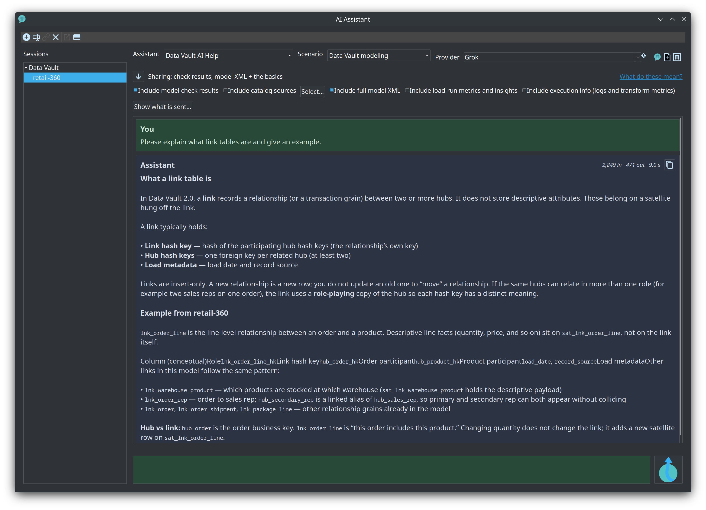
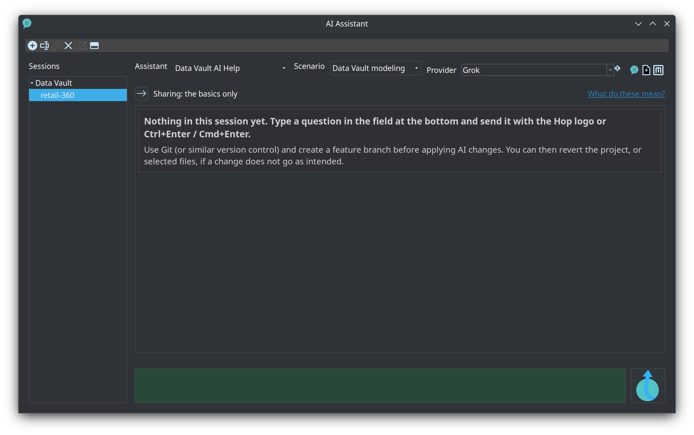

= Module 8 — AI help and the MCP server (optional)
:toc: left
:toclevels: 2
:sectanchors:

++++
<link rel="stylesheet" href="quiz.css" />
++++

== Why it matters

Data Hopper EDW ships an optional AI advisor: open a model, ask a question, and the answer is
grounded in the model and the plugin's own schema knowledge instead of general Data Vault advice.
The plugin also publishes a public MCP server, so AI coding assistants can read the same project
knowledge — coding rules, model schemas, documentation, plugin lookups — while someone edits files
outside Hop GUI.

Both features are optional, and knowing their limits prevents wasted trust. The advisor is
advisory: a fluent answer can still name a table that does not exist, and proposals are never
applied to your model automatically. Without that boundary in mind, "the AI said so" becomes a
data warehouse.

This module shows where the advisor appears, what it may read, how proposals are reviewed, and how
to point a coding assistant at the MCP server. Budget 20-30 minutes. No warehouse load is needed:
everything here works from model files. The prerequisites are Apache Hop 2.20 with the AI Assistant
plugin (`plugins/tech/ai`), a named **AI Provider** under **Metadata**, and AI enabled under
**Configuration → Plugins → AI Assistant**. hopper-edw itself still loads without the AI Assistant
plugin — AI Help is simply a no-op.

== Concepts

=== Where the advisors appear

hopper-edw's advisors are Hop 2.20 plugins implementing Hop's `IAiAdvisor` interface; the Hop **AI
Assistant** workbench drives them. The Data Vault, Business Vault and dimensional modelers open that
workbench bound to the open model: click **AI Help** on the modeler toolbar (next to **Check
model**), or right-click the canvas and choose **AI Help** under **Help**. An advisory **Scenario**
(for example **Data Vault Modeling**, **Source Analysis** or **Type Mapping**) tunes the answer to
your goal.

[cols="1,2", options="header"]
|===
|Surface |What the advisor does

|Data Vault, Business Vault and dimensional modelers (`.hdv`, `.hbv`, `.hdm`)
|Explains, analyzes, and can propose changes that you review and apply

|Source model (`.hsm`), lineage view (`.hlv`), execution map (`.hem`), EDW Journey
|Chat only — explains the open artifact, never edits it

|Pipelines (`.hpl`) and workflows (`.hwf`)
|Hop's own AI Help (part of Hop 2.20, not this plugin)
|===

=== Proposals are reviewed, never applied automatically

When a response contains actionable edits, a **Review N proposed change(s)** button appears in the
conversation. It opens the **Proposal Review Dialog**, where you select the changes to keep, read a
structural preview, see a **LOW** / **MEDIUM** / **HIGH** risk level, and skip the ones that would
invalidate the model — blocked proposals are unchecked automatically, with the reason shown. Only
**Apply** writes your selection into the open modeler, and it registers an undo point.

Proposal types cover every modeler: add a hub, link or satellite; set business keys or a record
source; rename or move a table; add a note; change a configuration property such as
`targetTableParallelCopies`; add an SCD2 or PIT table or a business table to a Business Vault; add a
dimension, fact, bridge or junk dimension to a dimensional model. The complete table is in the AI
advisory guide.

=== What the advisor may read

The model file is not the only input, and the prompt is not the only output. Before sending, you
choose the **Context Inclusions** that travel with the prompt:

* **Include model check results** — runs **Check model** on the open model and appends the result.
* **Include catalog sources** — the catalog record definitions you explicitly select.
* **Include full model XML** — the whole model file, sent on the first turn only.
* **Include load-run metrics and insights** — recent `load_run` data and rule-based insights from
  the OPS catalog; auto-enabled by the **Performance tuning** scenario.

A sibling `.hsm` next to the open `.hdv` also contributes a compact classification JSON, so the
advisor can talk about sources without you attaching anything. Privacy follows the same logic: API
keys never travel in prompts, database connection descriptions are redacted to name, type, database
name and host (usernames, passwords, ports and URLs are excluded), and only the catalog schemas and
model components you explicitly approve are uploaded.

=== The MCP server: project knowledge for coding assistants

The repository's `mcp/README.md` documents the public Model Context Protocol server, which gives AI
coding assistants a standard way to read the project's knowledge. The endpoint is
`https://mcp.data-hopper.com/mcp`; supported clients include Claude Desktop, Cursor, Antigravity,
VS Code (Roo Code / Cline / Continue) and Goose. Five tools are exposed:

* `get_coding_rules(topic)` — coding rules such as HopVfs usage, Lombok, i18n escaping and the Java
  21 pin.
* `get_model_schema(file_type)` — specification, schema text, anti-patterns and sample paths for the
  model file types.
* `search_knowledge_base(query, category)` — short snippets across docs, rules, schemas and code.
* `lookup_plugin_component(keyword, plugin_type)` — transforms, actions, metadata and GUI classes.
* `query_knowledge_graph(cypher)` — one read-only Cypher statement against the knowledge graph.

Only the last tool needs Neo4j; if it is down, the other four still answer. A client is configured
with a small block — the same one that ships in `.mcp.json` and `.cursor/mcp.json` at the repository
root:

[source,json]
----
{
  "mcpServers": {
    "datahopper": {
      "url": "https://mcp.data-hopper.com/mcp"
    }
  }
}
----

=== The AI file-schema pack for external agents

Not every edit happens in Hop GUI. The repository ships a portable context pack under
`docs/ai-file-schemas/`: XSD and JSON Schema plus purpose markdown for the `.hdv`, `.hbv`, `.hdm`
and `.hsm` model files, project metadata JSON, and catalog record definitions. Start with
`conventions.md` and `cross-references.md`, attach the file-type docs that match the edit, and
prefer editing an existing sample under `retail-example/` or `integration-tests/` over inventing
structure. After structural edits, open the file in Hop GUI and run **Check model**.

== Guided walkthrough

=== Ask the Data Vault advisor about a link

. Open `models/retail-360.hdv` from the `retail-example` project in the modeler.
. Click **AI Help** on the modeler toolbar (next to **Check model**).
. Keep the **General** scenario, or select **Data Vault Modeling**, and ask about link satellites —
  the advisor explains LSAT semantics and cites tables from your open model.
. Read the answer and note which of your model's tables it names; you will verify one of them in
  *Try it yourself*.
+

. Use the workbench controls for the next question: the scenario, the **Context Inclusions** and
  the prompt field are all part of the conversation, and **Send** runs the prompt in the background
  while the transcript updates when the answer is ready.
+

=== Review a proposal before you apply it

. Ask for a change — for example, in the **Data Vault Modeling** scenario, review one satellite and
  suggest what it is missing.
. When the response contains proposed changes, press **Review N proposed change(s)** in the
  transcript.
+
image::../images/data-vault-ai-help-review-proposals-dialog.png[The Proposal Review Dialog,align="center"]

. Read the risk level, the warnings and the preview of each change; blocked entries stay unchecked.
  Select only what you want, then press **Apply** — or close the dialog and change nothing. If you
  apply, undo is available on the modeler toolbar.
. Optional: on a modeler with load history, select the **Performance tuning** scenario, enable
  **Include load-run metrics and insights**, and ask how to speed up a load. A proposal may raise
  the parallel copies of a target table; read it in the review dialog before you apply it.
+
image::../images/ai-advisor-proposal-review-increase-parallelism.png[A reviewed proposal that raises the target table parallel copies,align="center"]

=== Optional: connect a coding assistant to the MCP server

. Optional: copy the client block from the *Concepts* section (or `mcp/README.md`) into your
  MCP-capable client's configuration — the same block ships in `.mcp.json` and `.cursor/mcp.json`.
. Call `get_coding_rules` with a topic, or `search_knowledge_base` with a question, and read the
  snippets that come back. This runs outside Hop GUI; nothing in the GUI changes.

== Try it yourself

Ask the advisor one question about your own model and check whether the answer cites model elements
you can verify:

. Open one of your own `.hdv` files (or use `retail-360.hdv` again) in the modeler.
. Before sending, write down the **Context Inclusions** you enabled — that list is what the advisor
  can see.
. Ask a specific question about one table, for example which fields a satellite carries or which
  hubs a link connects.
. For every table or field the answer names, open the modeler and confirm that it exists.

Check your work: you can name which parts of the model the advisor read (the open model plus your
inclusions), and every claim you checked holds. If the answer names something that does not exist,
the model is right and the answer is wrong — the advisor is advisory, and **Check model** is the
validation that counts.

== Questionnaire

Answer the eight questions. Every answer comes with its reasoning, and **Copy my results** gives you
a text summary to keep.

++++

  

    
1. Which AI Help surface can apply changes to the open artifact after you review them?

    

      <button type="button" class="edw-quiz-option">a) The EDW Journey perspective</button>
      <button type="button" class="edw-quiz-option">b) The lineage view (<code>.hlv</code>)</button>
      <button type="button" class="edw-quiz-option">c) The execution map (<code>.hem</code>)</button>
      <button type="button" class="edw-quiz-option" data-correct="true">d) The Data Vault modeler (<code>.hdv</code>)</button>
    

    
<strong>d)</strong> The Data Vault, Business Vault and dimensional modelers surface proposals (<code>dv_proposals</code>) that you can review and apply, and Hop's pipeline and workflow AI Help can do the same on graphs. The EDW Journey, source-model, lineage-view and execution-map advisors are chat-only: they explain the open artifact and never edit it.

  

  

    
2. A response proposes changes to your model. What happens immediately?

    

      <button type="button" class="edw-quiz-option">a) The changes are applied to the model as soon as the answer arrives</button>
      <button type="button" class="edw-quiz-option" data-correct="true">b) A <strong>Review N proposed change(s)</strong> button appears; nothing changes until you select changes and press <strong>Apply</strong></button>
      <button type="button" class="edw-quiz-option">c) The model is closed and reopened with the changes already in it</button>
      <button type="button" class="edw-quiz-option">d) The proposals are written straight to the target database</button>
    

    
<strong>b)</strong> Proposals stay in the conversation until you open the review dialog. There you see a preview, a LOW/MEDIUM/HIGH risk level and the validation status; changes that would invalidate the model are blocked and unchecked automatically. Applying registers an undo point.

  

  

    
3. What may the advisor read before it answers?

    

      <button type="button" class="edw-quiz-option">a) Every file in the project folder, automatically</button>
      <button type="button" class="edw-quiz-option">b) Only what you type in the prompt field</button>
      <button type="button" class="edw-quiz-option" data-correct="true">c) The open model plus the context inclusions you enable — check results, catalog sources, full model XML, and load-run metrics</button>
      <button type="button" class="edw-quiz-option">d) The target database, directly over JDBC</button>
    

    
<strong>c)</strong> Context is explicit: <strong>Include model check results</strong>, <strong>Include catalog sources</strong>, <strong>Include full model XML</strong> (first turn only) and <strong>Include load-run metrics and insights</strong>; a sibling <code>.hsm</code> contributes its classification JSON. Only schemas and components you approve are uploaded, connection descriptions are redacted to name, type, database and host, and API keys never travel in prompts.

  

  

    
4. What is the MCP server for in this project?

    

      <button type="button" class="edw-quiz-option">a) It runs the AI advisor inside Hop GUI</button>
      <button type="button" class="edw-quiz-option">b) It stores the warehouse model files</button>
      <button type="button" class="edw-quiz-option" data-correct="true">c) It gives AI coding assistants a standard way to read the project's coding rules, model schemas, documentation and plugin catalog</button>
      <button type="button" class="edw-quiz-option">d) It replaces <strong>Check model</strong> for models edited by external tools</button>
    

    
<strong>c)</strong> Data Hopper publishes a public Model Context Protocol server at <code>https://mcp.data-hopper.com/mcp</code>. Clients such as Claude Desktop, Cursor and VS Code connect to it and call tools like <code>get_coding_rules</code> and <code>search_knowledge_base</code>. It is project tooling for assistants — it does not run inside Hop GUI and does not touch your warehouse.

  

  

    
5. Which MCP tool returns the specification, schema text and anti-patterns for a file type such as <code>.hdv</code>?

    

      <button type="button" class="edw-quiz-option">a) <code>get_coding_rules</code></button>
      <button type="button" class="edw-quiz-option" data-correct="true">b) <code>get_model_schema</code></button>
      <button type="button" class="edw-quiz-option">c) <code>search_knowledge_base</code></button>
      <button type="button" class="edw-quiz-option">d) <code>query_knowledge_graph</code></button>
    

    
<strong>b)</strong> <code>get_model_schema(file_type)</code> returns the specification, schema text, anti-patterns and sample paths. <code>get_coding_rules</code> covers coding rules such as HopVfs and i18n; <code>search_knowledge_base</code> returns short snippets across docs, rules, schemas and classes; <code>query_knowledge_graph</code> runs one read-only Cypher statement — it is the only tool that needs Neo4j, and the other four still answer when Neo4j is down.

  

  

    
6. Where does the AI file-schema pack live?

    

      <button type="button" class="edw-quiz-option">a) In the plugin zip, under <code>docs/training</code></button>
      <button type="button" class="edw-quiz-option">b) Under <strong>Metadata</strong> in Hop GUI</button>
      <button type="button" class="edw-quiz-option" data-correct="true">c) In the repository, under <code>docs/ai-file-schemas</code></button>
      <button type="button" class="edw-quiz-option">d) On the MCP server only</button>
    

    
<strong>c)</strong> The pack holds XSD and JSON Schema plus purpose markdown for <code>.hdv</code>, <code>.hbv</code>, <code>.hdm</code> and <code>.hsm</code>, project metadata, and catalog record definitions. Attach <code>conventions.md</code> plus the matching file-type docs when an external assistant edits project files, and run <strong>Check model</strong> in Hop GUI after structural edits.

  

  

    
7. Scenario: an advisor answer contradicts what <strong>Check model</strong> reports. Which one wins?

    

      <button type="button" class="edw-quiz-option">a) The advisor — it read the full model XML</button>
      <button type="button" class="edw-quiz-option">b) Neither — only the schema gate can decide</button>
      <button type="button" class="edw-quiz-option" data-correct="true">c) <strong>Check model</strong> — the open model is the source of truth; validate the answer against it</button>
      <button type="button" class="edw-quiz-option">d) The advisor, if it used the <strong>Data Vault Modeling</strong> scenario</button>
    

    
<strong>c)</strong> The advisor is advisory and can be fluent and wrong at the same time. <strong>Check model</strong> validates the actual model, and the file-schema guidance says the same: after structural edits, open the file in Hop GUI and run <strong>Check model</strong>. Review any proposal, apply it, then check the model again.

  

  

    
8. Do AI Help and the MCP server need a loaded warehouse (tables in the Vault database)?

    

      <button type="button" class="edw-quiz-option">a) Yes — both read the loaded vault tables</button>
      <button type="button" class="edw-quiz-option">b) Yes for AI Help; the MCP server does not</button>
      <button type="button" class="edw-quiz-option" data-correct="true">c) No — AI Help works from the open model and the enabled context, and the MCP server answers from harvested knowledge</button>
      <button type="button" class="edw-quiz-option">d) No, but only for the MCP server</button>
    

    
<strong>c)</strong> The advisor can explain a model as soon as it opens; load-run metrics and last-run OPS appear only when they exist, and they auto-enable for the <strong>Performance tuning</strong> scenario. The MCP server does not connect to your warehouse at all.

  

++++

++++

++++

== Where to go next

* link:../ai-advisory.md[AI help and advisory] — prerequisites, providers, scenarios, context inclusions, proposal types and the privacy rules
* The **AI file-schema pack** (XSD and JSON Schema plus purpose docs for external agents) lives in
the repository under `docs/ai-file-schemas/` — it is not part of this offline documentation bundle.
* https://mcp.data-hopper.com/mcp — the public MCP server; tool list and client configuration in `mcp/README.md`
* link:index.adoc[Training index] — the other modules in this curriculum

'''

[.text-center]
link:index.adoc[← Back to the training index]
